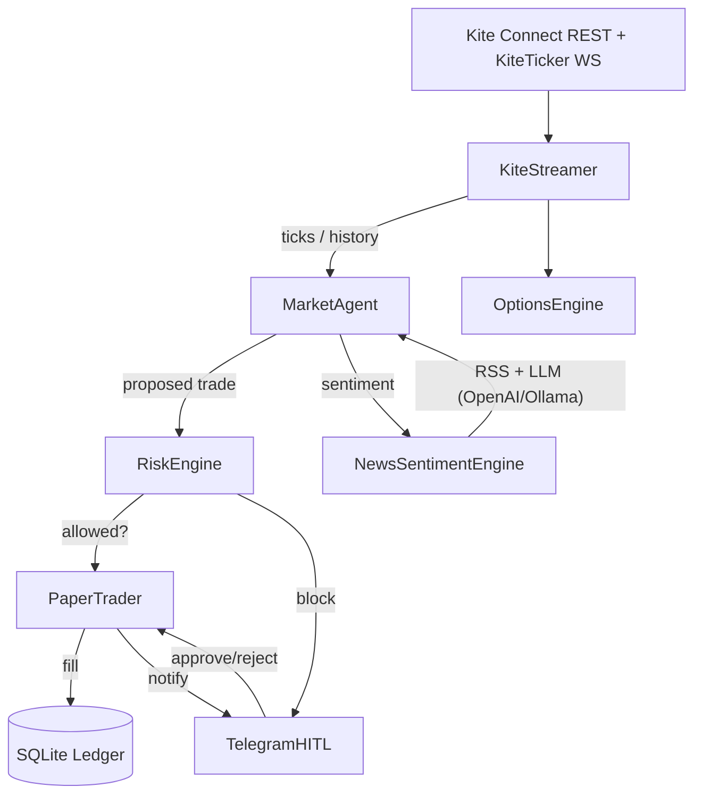

# 🪁 My Autonomous Kite Vault

**Personal agentic stock trading bot** for the **Zerodha Kite** ecosystem, written in
pure **TypeScript/Node.js** — no Python. It is built around a strict
**Human-in-the-Loop (HITL)** architecture and ships in **paper-trading mode**
(read-only against Kite) so you can validate the strategy against virtual
capital before any real money is involved.

> ⚠️ **v1 = paper trading only.** The bot never places real Kite orders. Every
> buy/sell is simulated and persisted to a local SQLite ledger for backtesting.

---

## Highlights

- 📡 **Real-time ticks** via KiteTicker (3s coalescing loop) + **historical data**
  via Kite Connect v3 REST (for RSI warmup).
- 📈 **Strategy:** RSI(14) mean-reversion guarded by an **ADX regime filter**
  (only trades ranging markets), **volume confirmation**, **ATR-based adaptive
  stop-losses**, **volatility-based position sizing**, a **circuit breaker**
  against whipsaw, and **time-of-day** filters. 15-min cooldown is a hard gate.
- 🧠 **AI sentiment** every 10 min: RSS-first (curated Indian financial feeds) +
  an LLM (OpenAI **or Ollama Cloud**) structured JSON scoring, with live model
  switching via Telegram. Optional **Tavily** live web search adds fresh,
  off-feed headlines + a 5-min detail loop. Falls back to a keyword heuristic if
  no API key is set.
- 🛡️ **RiskEngine** — immutable guardrails (daily drawdown, per-trade allocation,
  capital caps). Every risk decision is audited to the database.
- 👤 **Human-in-the-loop** via Telegram: tickets ≤ threshold auto-trade; above →
  approve/reject; `/stop` kill-switch; `/status` snapshot. Telegram is optional —
  all notifications are written to SQLite regardless.
- 💾 **SQLite** persistence (`better-sqlite3`) — 16 normalized tables, custom
  Liquibase-style migration runner, auto-bootstrap on first run.
- 📊 **Daily performance summary** — win rate, PnL, max drawdown computed on
  shutdown and persisted.
- 🩺 **Health checks** — component heartbeat every 5 min to `health_checks` table.
- 📝 **Structured logging** via pino — JSON in production, pretty-printed in dev.
- 📐 **Type-safe**, event-driven, modular (14 source files).

---

## Architecture



## Quick start

```bash
# 1. Install dependencies (requires Node 18+)
npm install

# 2. Configure environment
cp .env.example .env
# ... fill in your keys (see docs/CONFIGURATION.md)

# 3. Optionally edit your watchlist
# data/watchlist.json

# 4. Run in paper mode
npm run dev
```

> `better-sqlite3` is a native module. If `npm install` fails during its build,
> run it once without the sandbox/CI restrictions, or install with
> `--build-from-source`.

---

## Project layout

```
MyAutonomousKiteVault/
├── package.json
├── tsconfig.json
├── .env.example
├── .gitignore
├── README.md
├── Agents.md              # Contribution guide & engineering practices
├── docs/
│   ├── CONFIGURATION.md   # Deep-dive on every configurable entity
│   ├── CAPABILITIES.md    # What the bot can do in the stock market
│   └── BACKTESTING.md     # Backtest & optimization guide
├── migrations/
│   └── V001__initial_schema.sql  # DDL for all 16 tables
├── data/
│   └── watchlist.json     # Symbols to trade
├── test/
│   └── backtest/          # Backtest/simulate/optimize scripts (NOT in src/)
│       ├── backtest.ts
│       ├── optimize.ts
│       ├── simulate.ts
│       ├── run_all_modes.ts
│       └── test_*.ts
└── src/                   # PURE source code only
    ├── types.ts           # Shared domain types
    ├── Logger.ts          # Pino structured logger
    ├── AppConfig.ts       # Config loader (env + watchlist)
    ├── MigrationRunner.ts # Custom Liquibase-style migration engine
    ├── NotificationService.ts # DB-first notification system
    ├── RiskEngine.ts      # Immutable risk gatekeeper
    ├── MarketAgent.ts     # Strategy brain + loops
    ├── OptionsEngine.ts   # v2 options scaffolding
    ├── KiteStreamer.ts    # Kite REST + ticker wrapper
    ├── Ledger.ts          # SQLite persistence (16 normalized tables)
    ├── PaperTrader.ts     # Simulated execution
    ├── NewsSentimentEngine.ts # RSS + LLM sentiment
    ├── LlmManager.ts      # OpenAI/Ollama provider + model switching
    ├── TelegramHITL.ts    # Telegram notifications/approvals
    ├── MarketDataProvider.ts # Backtest vs Live provider interfaces
    ├── providers/
    │   ├── factory.ts     # createHistoricalProvider / createLiveProvider
    │   ├── YahooFinanceProvider.ts # account-free backtest data
    │   └── OpenBBProvider.ts # account-free OpenBB local REST API
    └── index.ts           # Entrypoint / wiring
```

## Commands

| Command            | Description                        |
| ------------------ | ---------------------------------- |
| `npm run dev`      | Run with `ts-node` (paper mode)    |
| `npm run build`    | Compile to `dist/`                 |
| `npm start`        | Run compiled output                |
| `npm run typecheck`| TypeScript check without emitting  |
| `npm run simulate` | Synthetic 2-min market simulation → `data/simulation_pnl.csv` |
| `npm run backtest` | Backtest vs real history → `data/backtest_report.csv` |
| `npm run optimize` | Parameter sweep + walk-forward → `data/optimization_report.csv` |
| `npm run test:backtest` | Self-test the onCandle backtest path |

Optimizer sweep modes: `npm run optimize -- --quick | --mid | --large | --xl`
(or `OPT_MODE=mid`). Run all modes: `npx ts-node test/backtest/run_all_modes.ts`.

## Documentation

- [`docs/CONFIGURATION.md`](docs/CONFIGURATION.md) — every configurable entity
- [`docs/CAPABILITIES.md`](docs/CAPABILITIES.md) — what the bot can do
- [`docs/BACKTESTING.md`](docs/BACKTESTING.md) — backtest & optimization guide
- [`Agents.md`](Agents.md) — contribution guide & engineering practices

## Backtesting (real Kite data, no real orders)

Backtest the strategy against historical candles and simulate every trade —
**no real orders are ever placed**. By default it uses **Yahoo Finance**
(account-free, no API key, no signup):

```bash
npm run backtest
# or tune it:
BACKTEST_INTERVAL=15minute BACKTEST_DAYS=90 BACKTEST_CAPITAL=500000 npm run backtest
```

- **`BACKTEST_PROVIDER=yahoo` (default):** account-free historical data.
- **`BACKTEST_PROVIDER=openbb`:** account-free OpenBB local REST API (Python).
- **`BACKTEST_PROVIDER=kite`:** real Zerodha Kite history (needs credentials).

Optional env: `BACKTEST_INTERVAL` (minute/5minute/15minute/day),
`BACKTEST_DAYS`, `BACKTEST_WARMUP_BARS`, `BACKTEST_CAPITAL`,
`BACKTEST_VOLUME_MULT`. Results go to `data/backtest_report.csv` and an isolated
`data/backtest/ledger.db`.

## Parameter optimization (multi-fold walk-forward)

Find the most robust strategy parameters by sweeping a grid and validating each
combo across **multiple rolling windows** (guards against overfitting):

```bash
npm run optimize
# tune the grid:
OPT_RSI_ENTRY="25,28,30,32,35" OPT_RSI_EXIT="65,68,70,72,75" \
OPT_ATR_MULT="1.5,2,2.5,3" OPT_ADX="20,25,30" OPT_STOP_LOSS="3,4,5" \
OPT_DAYS=120 OPT_FOLDS=4 OPT_TOP=5 npm run optimize
```

- The default grid sweeps **5×5×4×3×3 = 900 combos** across `RSI_ENTRY`,
  `RSI_EXIT`, `ATR_MULT`, `ADX`, and `STOP_LOSS`. Override any axis with the
  matching `OPT_*` env var (e.g. `OPT_RSI_ENTRY="25,30,35"`).

- The timeline is split into `OPT_FOLDS` windows; each combo's P&L is shown per
  fold. Combos marked **`✓ ALL`** are profitable in **every** window (most robust).
- Results are sorted by fitness and written to `data/optimization_report.csv`
  (one row per combo, per-fold P&L columns).
- An **equity-curve CSV** (cumulative P&L over time) is written for the top
  `OPT_TOP` combos into `data/equity_curves/` so you can chart them.
- Always validate the winning combo on data you did not optimize on.

---

## Configuration

Every configurable entity — **Zerodha Kite**, **RSS feeds**, **AI/LLM sentiment**
(OpenAI or Ollama Cloud), **Telegram HITL**, and **quantitative risk** — is
documented step by step in **[`docs/CONFIGURATION.md`](docs/CONFIGURATION.md)**.

## Legal & license

- **License:** GPL-3.0 (copyleft — fine for personal/private use).
- **"Kite"** is a trademark of Zerodha; this project is unofficial and not
  affiliated with Zerodha.
- **Not financial advice.** Trading involves risk. This bot is paper-only by
  design; use real capital at your own risk.
