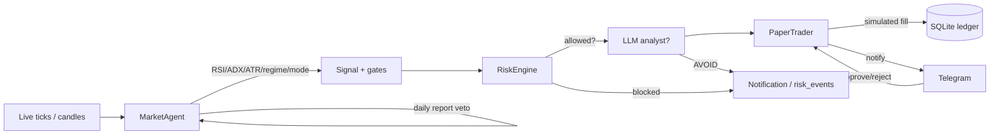

# Capabilities — What My Autonomous Kite Bot Can Do

This document explains, in plain terms, everything the bot can do in the stock
market, how it works, and what it is **not** (yet) able to do. It is the
"what does this thing actually do?" reference, and it reflects the **current**
state of the code (not the aspirational plan).

> **Read this first.** The bot runs two complementary strategy systems. The
> **momentum strategy** (`MomentumStrategy` + `signals/momentum.ts`) is the
> validated cross-sectional edge and the **single originator** of trade
> candidates, feeding the agent blackboard. The **`MarketAgent` + agent-fleet**
> design wired in `src/server/index.ts` runs the live loop, and the AI layer
> (news sentiment + 3-stage daily report + domain agents A–H on a shared
> blackboard) filters/vetoes/shrinks those candidates. Execution always routes
> through the immutable `RiskEngine`. See
> [Current state & known gaps](#current-state--known-gaps) for the honest
> picture.

---

## 1. The big picture

The bot is a **personal, agentic, paper-trading stock bot** for the Indian
market (NSE equities). It:

- Watches a **214-symbol watchlist** (`data/watchlist.json`).
- Streams **real market data** (live ticks or historical candles) from Zerodha
  Kite, with the `kite-paper-node` mock (a separate repo/package) for paper
  trading.
- Runs a **regime-adaptive technical strategy** (`MarketAgent`) that picks a
  mean-reversion / pullback-trend / breakout mode from RSI(14), ADX(14), ATR and
  SMA structure each cycle.
- Has an **AI/LLM layer** (news sentiment, analyst verdict, and a 3-stage daily
  report cycle) driven by an OpenAI-compatible provider (OpenAI, Ollama, or
  LiteLLM) with a multi-model **ensemble**.
- Has a **fleet of domain agents** (A–H) on a shared blackboard that produce
  per-symbol probes, sentiment, and a daily report three times a day.
- **Simulates** every trade against virtual capital (never places a real order).
- Enforces hard **risk gates** and records every blocked decision for audit.
- Persists everything to a **SQLite database** (16+ normalized tables, custom
  migration runner).
- Can notify you and ask for approval via **Telegram** (optional), and ships a
  **React web dashboard** backed by a small REST API.
- Logs every LLM call to `llm_traces` for inspection.

It is designed to be **validated on paper first** — you run backtests,
walk-forward validation, and simulations before ever considering real money.

---

## 2. What the runnable bot can do

### 2.1 Market data
- **Live real-time ticks** via Zerodha Kite websocket (`KiteStreamer`).
  With `PAPER_TRADING=true` it uses the `kite-paper-node` package (a separate
  repo) as a drop-in replacement instead of the real `kiteconnect` SDK.
- **30-day historical warmup** at boot (5-minute candles per enabled watchlist
  symbol) to seed RSI/ADX/ATR/SMA indicators before live ticks arrive.
- **Historical candles for backtesting** via an account-free provider (Yahoo
  Finance) or OpenBB/Kite.
- A read-only **Kite MCP client** (`KiteMcpClient`, `KITE_MCP_ENABLED`) that
  talks to a hosted or self-hosted Kite MCP server. It is hard-coded to an
  allowlist of **read-only** tools only (quotes, LTP, OHLC, historical data,
  instrument search, profile, margins, holdings, positions, MF holdings,
  orders, trades, order history/trades, GTTs) and can never place or modify an
  order.

### 2.2 Strategy brain — `MarketAgent` (RSI / ADX / ATR)
The bot classifies each symbol's market **regime** (trending_up / trending_down
/ ranging / volatile) from ADX + SMA structure + volatility, then **auto-selects**
a mode (`REGIME_ADAPTIVE`, default on):

- **mean_reversion** — buy RSI(14) oversold, exit on overbought / ATR target.
- **pullback_trend** — buy dips in an uptrend (fast SMA > slow SMA, price pulls
  back toward the slow SMA).
- **breakout** — buy momentum breakouts above a prior N-bar high with an ATR
  trailing stop.

In a downtrend it stays flat (does not catch falling knives). Entries pass a
stack of gates before a trade is even proposed:

- **Regime gate** (`REGIME_GATING_ENABLED`) and a **signal-confidence floor**
  (`MIN_SIGNAL_CONFIDENCE`) from indicator/sentiment agreement.
- **Minimum reward:risk** (`MIN_RISK_REWARD`) — target vs stop distance.
- **Opening Range Breakout (ORB)** filter (`ORB_ENABLED`) — gate entries on the
  first-N-minute range.
- **Daily-report veto** — if the latest AI daily report says AVOID for a symbol,
  entries are blocked until the report refreshes.
- **Circuit breaker** — halts entries after too many trades in a window
  (persists across restarts).
- **Cooldown**, **time-of-day** filter, and **correlation/concentration** caps.

Exits use ATR-adaptive stop-loss (never wider than a hard % cap), ATR-based
**take-profit**, **breakeven ratchet** (`BREAKEVEN_ATR_MULT`), and session/EOD
handling.

### 2.3 AI / LLM layer
- **Provider** (`LLM_PROVIDER`): `openai`, `ollama`, `litellm`, or `none`.
  Auto-detect order is Ollama → LiteLLM → OpenAI when no explicit choice is
  set. LiteLLM supports `LITELLM_BASE_URL` / `LITELLM_API_KEY` / `LITELLM_MODEL`
  for any OpenAI-compatible proxy.
- **Ensemble** — up to 3 models vote on sentiment / analyst / daily reports
  (`LLM_ENSEMBLE_MODELS`, `LLM_FAST_ENSEMBLE_MODELS`), with a fast/depth mode
  switch. Consensus is conservative: escalate to the most cautious verdict and
  average risk scores.
- **JSON mode** (`LLM_JSON_MODE`) + strict schema validation; invalid JSON falls
  back to a keyword heuristic.
- **News sources**: Google News RSS (always-on, keyless) + **TinyFish** live
  search (`TINYFISH_API_KEY`, `TINYFISH_MAX_RESULTS=5`) for fresh, off-feed
  headlines. Headlines are scored to `[-1, +1]` by the LLM.
- **Prompt-injection sanitization**: headlines are labelled as *data, not
  instructions*, and stripped before being placed in prompts.
- **Analyst verdict** (`ANALYST_ENABLED`): the LLM acts as a final analyst on a
  candidate trade (AGREE / CAUTION / AVOID + risk score). It is a **soft**
  filter — the immutable `RiskEngine` always runs first and the analyst can only
  reject, never force, a trade. LLM failures never block execution.
- **3-stage daily report cycle** — see below.

### 2.4 AI daily reports & agent fleet
`AgentsRuntime` drives two things:

- **A 3-stage daily report cycle** (`DailyReportEngine`): `pre_open` (09:00
  IST), `mid_session` (11:00 IST), `pre_close` (15:15 IST). Each stage produces a
  structured `DailyReport` JSON (market regime, capital management,
  stocks-to-watch, per-symbol recommendations with action bias, quantity,
  allocation, entry strategy, invalidation condition, summary). Multiple LLM
  models respond and their outputs are **merged by consensus** (average regime
  score and sentiment, majority action-bias label, union stocks-to-watch),
  then **clamped to available capital**.
- **The agent fleet** (domains A–H in `src/agents/`) — data ingestion, technical
  analysis, fundamentals/context, sentiment synthesis, portfolio/risk context,
  decision (regime/screener/validator/strategist/risk_precheck/execute),
  post-trade, and governance. They run on a **shared blackboard** (write-once
  payloads that downstream agents read instead of recomputing), ordered by
  dependency, with a probe scheduler that fires once per window per symbol
  (news + sentiment + persisted articles). `AGENTS_ENABLED=false` by default.

At `pre_close`, `EodEngine` also runs: **intraday (MIS) square-off** to avoid
overnight gap risk, **EOD performance logging**, and an **overnight gap-risk
matrix** for swing (CNC) positions.

### 2.5 Risk management (immutable gatekeeper — `RiskEngine`)
Every proposed trade is validated before it can reach the trader or HITL. The
AI can never override these checks. Gates: ticket size > 0; per-trade allocation
cap; single-stock cap; per-symbol add cap; sector cap; **daily** drawdown cap;
**portfolio** drawdown cap; **monthly** drawdown cap; single-trade **risk-at-stop**
cap; and **capital capacity + mandatory cash reserve**. Every block is persisted
to `risk_events` for audit. `capitalSnapshot()` feeds the advisory layer.

### 2.6 Human-in-the-loop (optional Telegram)
- Notifications for fills, risk blocks, sentiment, and status.
- **Approve/reject** prompts for trades above `AUTO_TRADE_TRADE_THRESHOLD`
  (`autoTradeTicketThreshold`); below that, trades auto-execute in paper.
- Commands include `/stop` kill-switch, `/status`, `/models`, `/model`, `/llm`.
- When Telegram is off, all notifications are still written to SQLite.

### 2.7 Realistic paper fills (net of costs)
`PaperTrader` applies adverse **slippage** and NSE-style **charges** (brokerage,
statutory, GST) via `PAPER_SLIPPAGE_BPS`, `PAPER_BROKERAGE_BPS`,
`PAPER_BROKERAGE_MAX`, `PAPER_STATUTORY_BPS`, `PAPER_GST_PCT`, so paper P&L
reflects what a live account would keep.

### 2.8 Options layer (SAFE, switchable)
- Switchable via `OPTIONS_ENABLED` (default OFF).
- **Buys options only** (defined risk = premium), priced via **Black-Scholes**
  with dynamic ATR-derived volatility.
- **Safety caps**: per-trade premium cap + total exposure cap, routed through
  the RiskEngine and persisted to the ledger.
- Driven by the technical signals — CALLs on upside breakouts, PUTs on downside
  breakdowns, closed on equity exit.

### 2.9 Backtesting, optimization & validation
- **Backtest** the strategy against real historical candles (no real orders).
- **Parameter optimizer** with **multi-fold walk-forward** validation and
  **equity-curve** exports; sweep modes `--quick` / `--mid` / `--large` / `--xl`.
- **Simulation** with synthetic market data for quick sanity checks.
- **Walk-forward / out-of-sample validation** (`npm run validate:strategy`)
  scores the live signal engine on rolling OOS folds **net of costs** and prints
  a blunt `VALIDATED` / `NOT VALIDATED` verdict. A green verdict is *necessary,
  not sufficient* (survivorship bias — see `docs/BACKTESTING.md`).

### 2.10 Web dashboard & observability (INCOMPLETE)
- **React web dashboard**: overview, candlestick charts, positions/orders/trades,
  signals, risk audit, notifications, and an **LLM Traces** page.
- **REST API** (read-only): `/api/overview`, `/api/positions`, `/api/orders`,
  `/api/trades`, `/api/signals`, `/api/risk-events`, `/api/notifications`,
  `/api/daily-summary`, `/api/health`, `/api/watchlist`,
  `/api/candles?symbol=&interval=`, `/api/candle-intervals`, `/api/llm-traces`,
  `/api/fleet/probes`, `/api/fleet/news`, `/api/fleet/signals`,
  `/api/fleet/reports`, `/api/eod/performance`, `/api/eod/overnight-matrix`,
  `/api/healthz`, plus a WebSocket for live refresh.
- **`llm_traces`**: every LLM call (sentiment, analyst verdict, holdings verdict,
  daily reports) is logged with prompt/response/latency so you can inspect *why*
  the AI decided what it did.
- **LLM audit scripts**: `npm run audit:code`, `npm run audit:strategy`, and
  `npm run audit:profit` produce architecture / guardrail / strategy /
  profitability review reports in `src/server/audit-report/`.

---

## 3. How a trade happens (end-to-end)

1. A tick or closed bar arrives → indicators update (RSI/ADX/ATR/SMA).
2. The regime is classified and the matching mode (mean_reversion /
   pullback_trend / breakout) is selected.
3. If an entry condition is met and all gates pass (regime, confidence, R:R,
   ORB, report veto, circuit breaker, cooldown), a trade is **proposed**.
4. The **RiskEngine** checks drawdown, concentration, sector, risk-at-stop, and
   capital/cash reserve.
5. If the LLM **analyst** is enabled, it may reject (soft filter).
6. If the ticket is small, it auto-executes in paper; if large, Telegram asks
   for approval.
7. The **PaperTrader** simulates the fill (net of slippage + charges) and
   records it to SQLite.
8. Exits happen on ATR take-profit, RSI overbought, breakeven ratchet, ATR
   stop-loss, or session close / EOD square-off.

---

## 4. Quick-start commands

These are the `package.json` scripts that **exist** in the current repo:

| Command | What it does |
|---------|--------------|
| `npm run dev` | Run the live bot (paper mode) |
| `npm run build` / `npm run start` | Compile & run from `dist/` |
| `npm run typecheck` | `tsc --noEmit` + agents typecheck |
| `npm run backtest` | Backtest vs real history (account-free Yahoo) |
| `npm run optimize -- --mid` | Parameter sweep (mid grid) |
| `npm run simulate` | Synthetic market simulation |
| `npm run ab:compare` | A/B compare two configurations |
| `npm run agents:dryrun` | Dry-run the agent fleet without the server |
| `npm run chart` | Plot equity curves |
| `npm run test:backtest` | Self-test the backtest path |
| `npm run validate:strategy` | Walk-forward OOS validation of the live signal engine |
| `npm run dev:ui` / `dev:all` / `build:ui` / `typecheck:ui` / `mock:ui` | Dashboard tooling |
| `npm run audit:code` / `audit:strategy` / `audit:profit` | LLM audit reports |

See `docs/CONFIGURATION.md`, `docs/BACKTESTING.md`, and `docs/UI_DASHBOARD.md`
for details.

---

## 5. Current state & known gaps

This section is deliberately honest about what **is** and **is not** in the
runnable bot today.

### 5.1 The runnable bot today

The entrypoint `src/server/index.ts` wires: `Ledger`, `RiskEngine`,
`PaperTrader`, `NewsSentimentEngine`, `TelegramHITL`, `LlmManager`,
`OptionsEngine` / `OptionsTrader`, **`MarketAgent`** (the strategy brain),
`NotificationService`, `createLiveProvider` (KiteStreamer), the UI server,
**`AgentsRuntime`** (agent fleet + `DailyReportEngine` + `EodEngine`). It does a
30-day RSI/ADX/ATR warmup, a 3-second coalescing tick loop into
`MarketAgent.onTicks`, a 10-min news loop, a 5-min news-detail loop, a 5-min
health heartbeat, and the agent probe scheduler.

The **strategy the runnable bot executes is the `MarketAgent` regime-adaptive
RSI/ADX/ATR design** plus the agent-fleet / 3-stage daily-report layer.

### 5.2 Momentum strategy: wired, validated, and the single originator

The **momentum** strategy engine (`MomentumStrategy` + `src/server/signals/momentum.ts`
+ `LiveTrader` + `OrderGuard` + `Reconciler` + `StrategyOptimizer` +
`StrategyAdaptation`, and migrations V011–V015) is **wired end-to-end** and
type-checks cleanly (`tsc --noEmit` = 0 errors):

- The momentum config keys (`momentumTopN`, `momentumLookbackMonths`,
  `momentumHysteresisBand`, `momentumLiquidityFloorInr`,
  `momentumLiquidityLookbackDays`, `momentumRiskOff`, `newsVetoThreshold`,
  `risk.minCapital`, `eventBlackoutTypes`, `eventBlackoutDays`) and the `live`
  block are now read by `AppConfig` (previously the `.env` had them but the
  loader did not).
- The `Ledger` accessors they need (`getStrategyParam`, `setStrategyParam`,
  `getClosedTrades`, `claimOrderIntent`, `settleOrderIntent`,
  `setBrokerOrderIdForTrade`, `recordReconciliation`, `getRecentReconciliations`,
  `recordAgentProposal`, `getAgentProposals`, `shadowBookMonths`,
  `scoreShadowBook`, `realizedPnlByMonth`) are implemented.
- The momentum engine is the **single originator** of trade candidates on the
  agent blackboard; the AI layer (DailyReportEngine + domain agents) only
  vetoes/shrinks/re-ranks them. Execution routes through `LiveTrader` → the
  `RiskEngine` gate.
- The walk-forward gate **VALIDATES** at 36.99% annualized net (+26.84pp over
  Nifty) — see `docs/BACKTESTING.md`.

### 5.3 `package.json` scripts

The `test:momentum|risk|indicators|live|feedback|agents|execution|tax|shadow|
authority|ladder`, `test:unit`, `validate:momentum`, `score:shadow`,
`status:golive`, `attribute:leaks`, `estimate:survivorship`, and `ci` scripts are
all present. `npm run test:unit` is green (11 suites) and `npm run ci` runs the
unit suite then `validate:momentum`.

### 5.4 Paper-only; no real orders

- **Does not place real orders by default.** Everything is paper/simulated
  through `kite-paper-node`. A real execution path (`LiveTrader`) is built
  behind a hard `ALLOW_LIVE_ORDERS` gate with shadow mode (`LIVE_SHADOW_MODE`),
  order idempotency (`OrderGuard`), and broker reconciliation (`Reconciler`); it
  is wired but **off by default** and never fires without explicit opt-in.
- **No true account-free live streaming.** Live ticks require a broker account
  (Kite) or the `kite-paper-node` mock. Yahoo is historical-only.
- **Not financial advice.** It is a research/validation tool, not a guarantee
  of profit.

---

## 6. Related documents

- `docs/STRATEGIES_TECHNIQUES.md` — deep analysis of every strategy and
technique in the project.
- `docs/CONFIGURATION.md` — full environment-variable configuration.
- `docs/BACKTESTING.md` — backtest / optimize / walk-forward workflow.
- `docs/OBSERVABILITY.md` — `llm_traces` and the LLM audit scripts.
- `docs/UI_DASHBOARD.md` — the React dashboard and REST API.
