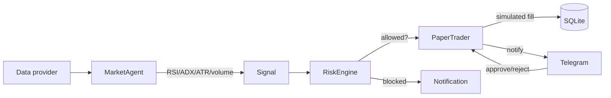

# Capabilities — What My Autonomous Kite Vault Can Do

This document explains, in plain terms, everything the bot can do in the stock
market, how it works, and what it is **not** (yet) able to do. It is the
"what does this thing actually do?" reference.

---

## 1. The big picture

The bot is a **personal, agentic, paper-trading stock bot** for the Indian
market (NSE equities). It:

- Watches a configurable **watchlist** of stocks.
- Computes technical indicators from **real market data** (live ticks or
  historical candles).
- Generates **buy/sell signals** using a mean-reversion strategy.
- **Simulates** every trade against virtual capital (never places a real order).
- Persists everything to a **SQLite database** for audit and backtesting.
- Can notify you and ask for approval via **Telegram** (optional).
- Uses an **AI/LLM** to score news sentiment (optional).

It is designed to be **validated on paper first** — you run backtests and
simulations before ever considering real money.

---

## 2. What it can do

### 2.1 Market data (switchable providers)
- **Live real-time ticks** via Zerodha Kite websocket (`LIVE_PROVIDER=kite`).
- **Historical candles** for backtesting via **Yahoo Finance** (account-free,
  default) or **OpenBB** (account-free local server) or **Kite**.
- Delayed quotes via Yahoo.

### 2.2 Strategy & signals
- **Three strategy modes** (`STRATEGY_MODE`):
  - `mean_reversion` — RSI(14) oversold entry, overbought exit.
  - `pullback_trend` — buy dips in an uptrend (fast SMA > slow SMA).
  - `breakout` — buy momentum breakouts above a prior N-bar high, with an ATR
    trailing stop (best on daily bars).
- **ADX regime filter**: only trades in *ranging* markets (mean-reversion).
- **Volume confirmation**: requires volume above a multiple of the average.
- **ATR-based adaptive stop-loss**: stop distance scales with volatility, never
  wider than a hard cap.
- **Volatility-based position sizing**: quantity scaled by a risk-per-trade
  budget and ATR.
- **Circuit breaker**: halts entries after too many trades in a window (stops
  whipsaw).
- **Time-of-day filter**: skips the noisy first/last minutes of the session.
- **Correlation cap**: limits simultaneous open positions (concentration risk).
- **Cooldown**: minimum time between trades (immutable gate).

### 2.3 AI / sentiment
- **RSS-first news** from curated Indian financial feeds.
- **Tavily live web search** (optional): adds fresh, off-feed headlines and a
  5-min detail loop with an AI answer.
- **LLM scoring** (OpenAI or Ollama Cloud) turns headlines into a structured
  sentiment score (`-1` bearish … `+1` bullish).
- Sentiment is used as a **confirmation filter** (avoid entries into strongly
  bearish news).
- Falls back to a keyword heuristic if no LLM is configured.

### 2.4 Risk management (immutable gatekeeper)
- **Daily drawdown cap** — halts trading if the day's loss exceeds a limit.
- **Per-trade allocation cap**.
- **Capital capacity check** — never over-allocates.
- Every risk decision is **audited** to the database.

### 2.5 Human-in-the-loop (optional Telegram)
- Notifications for fills, risk blocks, sentiment, and status.
- **Approve/reject** prompts for large trades.
- `/stop` kill-switch, `/status`, `/models`, `/model`, `/llm` commands.
- When Telegram is off, all notifications are still written to SQLite.

### 2.6 Backtesting & optimization
- **Backtest** the strategy against real historical candles (no real orders).
- **Parameter optimizer** with **multi-fold walk-forward** validation and
  **equity-curve** exports.
- Sweep modes: `--quick`, `--mid`, `--large`, `--xl`.
- **Simulation** with synthetic market data for quick sanity checks.

### 2.8 Options layer (SAFE, switchable)
- **Switchable** via `OPTIONS_ENABLED` (default OFF).
- **Buys options only** (defined risk = premium), priced via Black-Scholes.
- **Safety caps**: per-trade premium cap + total exposure cap.
- **Driven by the breakout signal** — buys CALLs on upside breakouts, PUTs on
  downside breakdowns, closes on equity exit.

### 2.9 Data & observability
- **16-table normalized SQLite schema** with a custom migration runner.
- **Pino structured logging** (JSON in prod, pretty in dev).
- **Health checks**, **sessions**, **daily performance summaries**.
- **CSV exports** for P&L, backtest reports, and equity curves.

---

## 3. What it does NOT do (yet)

- **Does not place real orders.** Everything is paper/simulated. Real execution
  is a deliberate future step (v2) after backtest validation.
- **No options execution.** The `OptionsEngine` is a scaffold; v1 trades
  equities only.
- **No true account-free live streaming.** Live ticks require a broker account
  (Kite) or a paid provider. Yahoo is historical-only.
- **Not financial advice.** It is a research/validation tool, not a guarantee
  of profit.

---

## 4. How a trade happens (end-to-end)

1. A tick or candle arrives → indicators update.
2. If RSI is oversold and all guards pass (ADX, volume, time, cooldown,
   circuit breaker, correlation), a **LONG** signal is generated.
3. The **RiskEngine** checks drawdown, allocation, and capital.
4. If the ticket is small, it auto-executes in paper mode; if large, it asks
   Telegram for approval.
5. The **PaperTrader** simulates the fill and records it to SQLite.
6. Exits happen on RSI overbought, ATR stop-loss, or session close.

---

## 5. Quick-start commands

| Command | What it does |
|---------|--------------|
| `npm run dev` | Run the live bot (paper mode) |
| `npm run backtest` | Backtest vs real history (account-free Yahoo) |
| `npm run optimize -- --mid` | Parameter sweep (mid grid) |
| `npm run simulate` | Synthetic market simulation |
| `npm run test:backtest` | Self-test the backtest path |

See `docs/CONFIGURATION.md` for full configuration and
`docs/BACKTESTING.md` for the backtest/optimize workflow.
