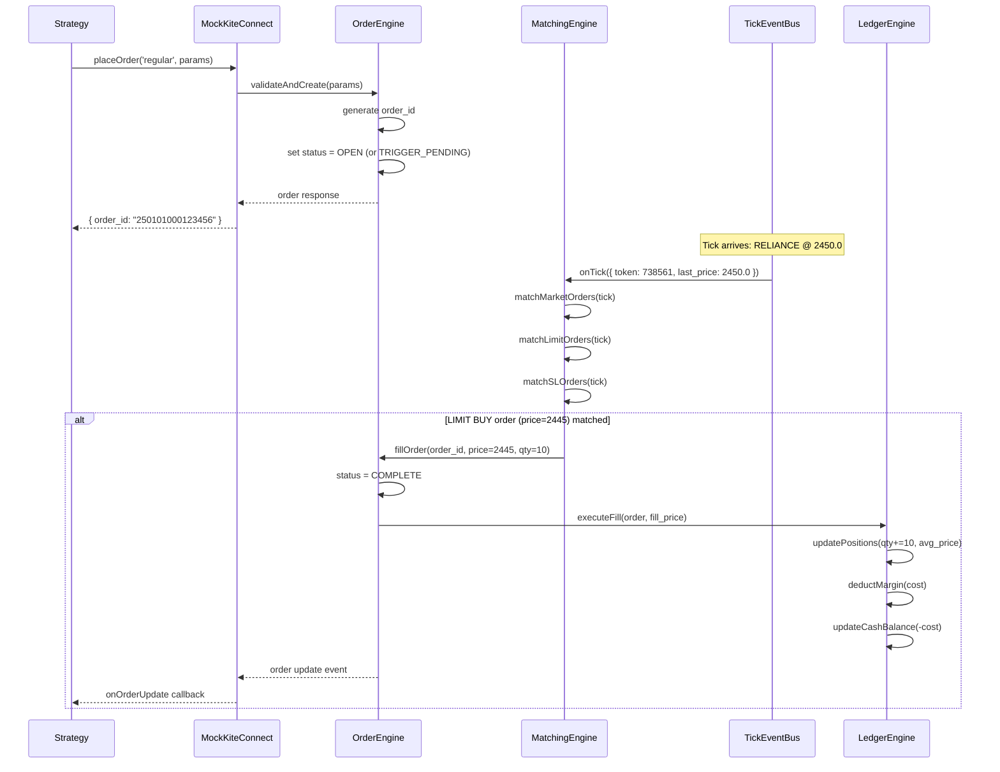
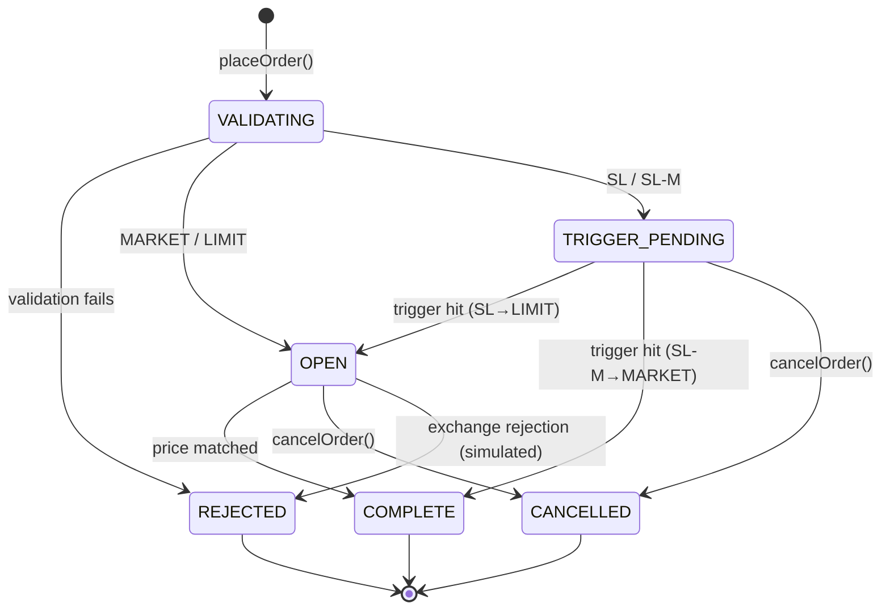
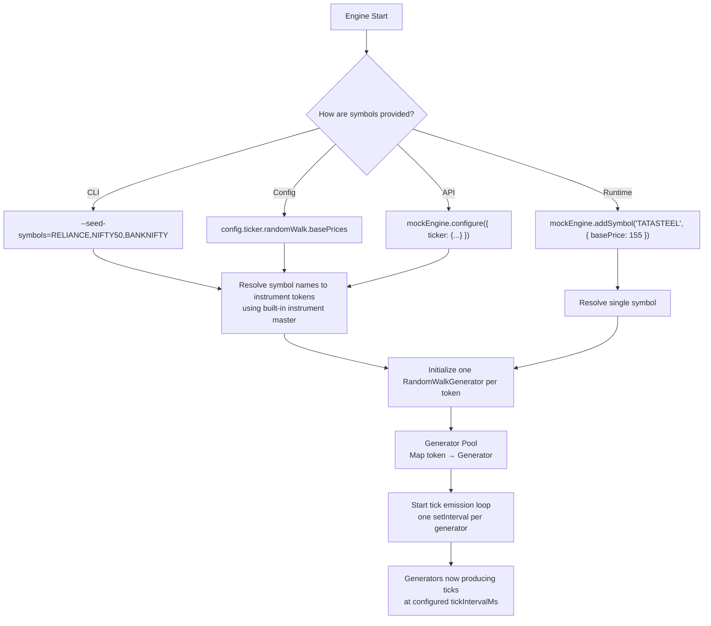
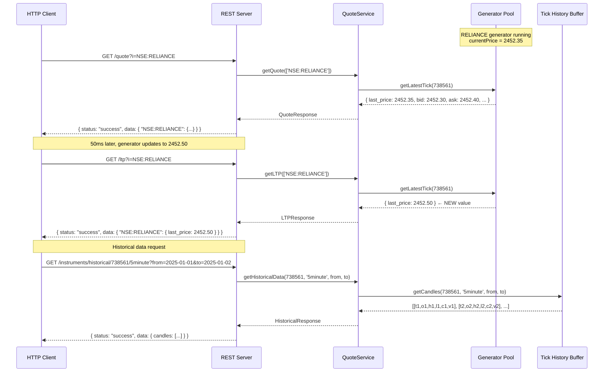
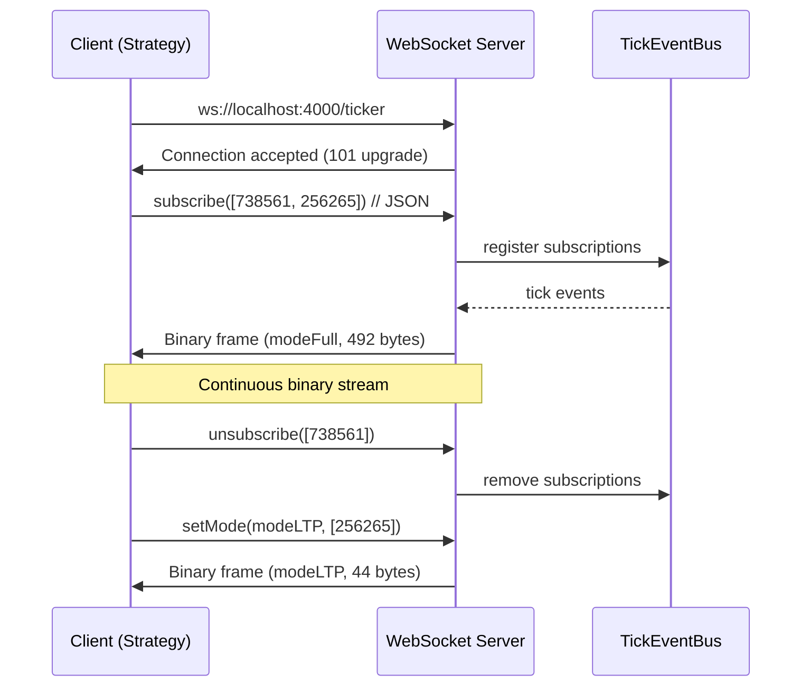
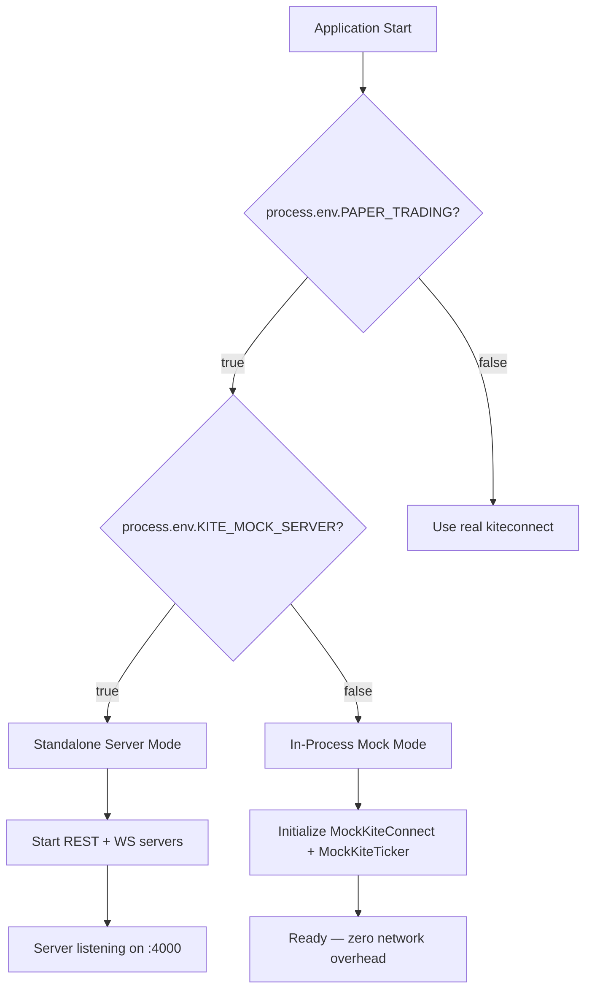
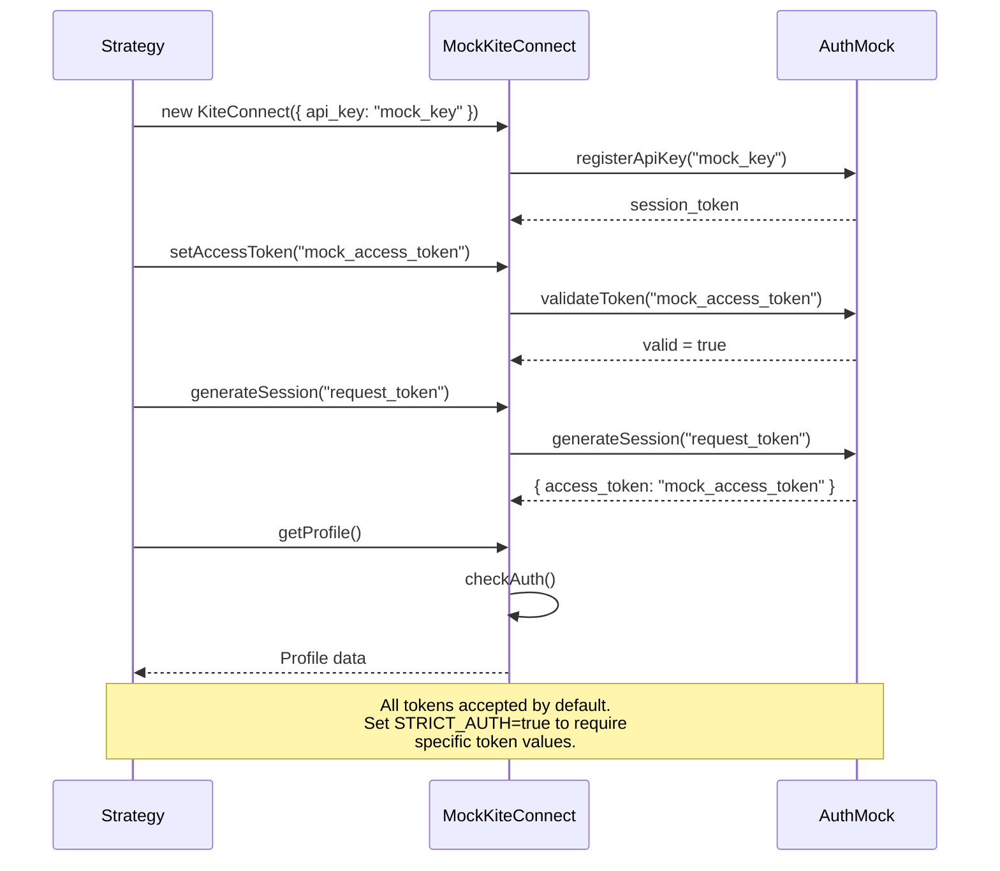
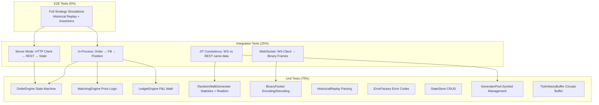

# `kite-paper-node` — Comprehensive Architecture & Design Document

> **Status:** Pre-Implementation Design | **Version:** 1.0.0-draft
> **Audience:** Principal Engineers, Contributors, AI Coding Agents
> **Principle:** 540° analysis — every dimension examined before a single line of code is written.

---

## Table of Contents

1. [Executive Summary & Vision](#1-executive-summary--vision)
2. [System Architecture Overview](#2-system-architecture-overview)
3. [Module Decomposition](#3-module-decomposition)
4. [Order Matching Engine — Deep Dive](#4-order-matching-engine--deep-dive)
5. [Market Data & Ticker Simulation](#5-market-data--ticker-simulation)
   - [5.1 Data Source Architecture](#51-data-source-architecture)
   - [5.2 Random Walk Generator — Algorithm](#52-random-walk-generator--algorithm)
   - [5.3 Historical Replay Engine](#53-historical-replay-engine)
   - [5.4 KiteTicker Mode Emulation](#54-kiteticker-mode-emulation)
   - [5.5 Tick Injection API (Deterministic Testing)](#55-tick-injection-api-deterministic-testing)
   - [5.6 JIT Data Generation Strategy](#56-jit-data-generation-strategy)
6. [REST API Surface — Complete Specification](#6-rest-api-surface--complete-specification)
7. [WebSocket Protocol — Binary Frame Design](#7-websocket-protocol--binary-frame-design)
8. [State Management & Persistence](#8-state-management--persistence)
9. [Dual Execution Modes — Runtime Architecture](#9-dual-execution-modes--runtime-architecture)
10. [Authentication & Session Mocking](#10-authentication--session-mocking)
11. [Error Handling, Edge Cases & Resilience](#11-error-handling-edge-cases--resilience)
12. [Deterministic Testing Framework](#12-deterministic-testing-framework)
13. [TypeScript Type System Design](#13-typescript-type-system-design)
14. [CLI & Developer Experience](#14-cli--developer-experience)
15. [Packaging, Distribution & npm](#15-packaging-distribution--npm)
16. [Performance & Scalability Analysis](#16-performance--scalability-analysis)
17. [Observability, Logging & Debugging](#17-observability-logging--debugging)
18. [Security Considerations](#18-security-considerations)
19. [Compatibility Matrix](#19-compatibility-matrix)
20. [Testing Strategy — All Layers](#20-testing-strategy--all-layers)
21. [Migration & Adoption Guide](#21-migration--adoption-guide)
22. [Risk Analysis & Mitigations](#22-risk-analysis--mitigations)
23. [Future Roadmap & Extensibility](#23-future-roadmap--extensibility)
24. [Appendix: Glossary, References & Decision Log](#24-appendix-glossary-references--decision-log)

---

## 1. Executive Summary & Vision

### 1.1 What This Is

`kite-paper-node` is a **zero-dependency, open-source paper trading harness and mock engine** for Zerodha's `kiteconnect` Node.js client library. It provides a **1:1, drop-in substitute** for `KiteConnect` (REST) and `KiteTicker` (WebSocket) such that algorithmic trading developers can switch between live Zerodha Kite APIs and a fully simulated paper-trading environment by changing a single environment variable — with **zero code changes** to their strategy logic.

### 1.2 Core Value Proposition

| Dimension | Live `kiteconnect` | `kite-paper-node` |
|-----------|-------------------|-------------------|
| **Broker account required?** | Yes (Zerodha) | No |
| **Real money at risk?** | Yes | No |
| **Network dependency?** | Yes (Kite servers) | No (in-process mode) |
| **Deterministic testing?** | No | Yes (tick injection API) |
| **Historical replay?** | No | Yes (CSV/array replay) |
| **Latency** | ~50-200ms network | ~0ms (in-process) |
| **Rate limits?** | Yes (Kite API limits) | No |
| **Cost** | Brokerage + API fees | Free (MIT) |
| **Data generation** | Real market data from exchange | **100% JIT** — prices, volumes, OHLC generated algorithmically at runtime; zero static price data |

### 1.3 Design Philosophy

1. **Zero Friction Switchover** — `PAPER_TRADING=true` is the only change needed.
2. **Protocol Fidelity** — Binary WebSocket frames, REST response schemas, and error codes must be byte-for-byte compatible with real Kite.
3. **Zero Runtime Dependencies** — Core engine uses only Node.js built-ins (`events`, `buffer`, `http`, `crypto`, `net`). Optional server mode may use `express` and `ws` as dev-optional peer dependencies.
4. **Determinism First** — Every non-random behavior must be reproducible. Randomness is explicit, seeded, and overridable.
5. **Testability as a Feature** — The mock engine is a testing tool first, a paper-trading simulator second.
6. **100% JIT Data Generation** — All market data (prices, volumes, bid/ask, OHLC, depth) is generated algorithmically at runtime. The only static data is the instrument master (symbol→token mapping). No pre-baked price files, no hardcoded OHLC values, no stale caches. Every REST API call and WebSocket frame reflects the **live, evolving state** of the Random Walk Generator for that symbol.

### 1.4 Target Users

| Persona | Use Case |
|---------|----------|
| **Algo Developer (Node.js)** | Develop & debug strategies locally without a broker account |
| **Algo Developer (Python/Go)** | Test against standalone server over HTTP/WS from any language |
| **QA Engineer** | Deterministic integration tests with injected price shocks |
| **CI/CD Pipeline** | Automated strategy validation in GitHub Actions / Jenkins |
| **Educator/Student** | Learn algorithmic trading without financial risk |

---

## 2. System Architecture Overview

### 2.1 High-Level Component Diagram

```mermaid
graph TB
    subgraph "User Strategy Code"
        STRATEGY[Strategy Logic]
    end

    subgraph "kite-paper-node Boundary"
        subgraph "Facade Layer"
            KC_MOCK[MockKiteConnect]
            KT_MOCK[MockKiteTicker]
        end

        subgraph "Core Engine"
            OE[Order Engine]
            ME[Matching Engine]
            LE[Ledger Engine]
            PE[Position Engine]
            ME2[Margin Engine]
        end

        subgraph "Market Data"
            RWG[Random Walk Generator Pool<br/>one instance per symbol]
            HRE[Historical Replay Engine]
            TICK_BUS[Tick Event Bus]
            OHLC_AGG[OHLC Aggregator]
            TICK_HIST[Tick History Buffer<br/>circular, per-symbol]
        end

        subgraph "Server Layer (Optional)"
            REST[REST API Server<br/>Express]
            WS[WebSocket Server<br/>ws]
            BIN_PACK[Binary Packet Packer]
        end

        subgraph "State Store"
            ORDERS[(Orders Store)]
            POSITIONS[(Positions Store)]
            HOLDINGS[(Holdings Store)]
            MARGINS[(Margins Store)]
            GTT[(GTT Store)]
        end
    end

    STRATEGY -->|new KiteConnect()| KC_MOCK
    STRATEGY -->|new KiteTicker()| KT_MOCK
    KC_MOCK --> OE
    KC_MOCK --> PE
    KC_MOCK --> LE
    KT_MOCK --> TICK_BUS
    TICK_BUS --> RWG
    TICK_BUS --> HRE
    TICK_BUS --> ME
    TICK_BUS --> OHLC_AGG
    OHLC_AGG --> TICK_HIST
    ME --> OE
    OE --> ORDERS
    OE --> POSITIONS
    PE --> POSITIONS
    PE --> HOLDINGS
    LE --> MARGINS
    ME2 --> MARGINS

    KC_MOCK -.->|Standalone Mode| REST
    KT_MOCK -.->|Standalone Mode| WS
    WS --> BIN_PACK
    REST --> RWG
    REST --> TICK_HIST
```

### 2.2 Layered Architecture

```
┌─────────────────────────────────────────────────────┐
│                 PUBLIC API SURFACE                    │
│  MockKiteConnect  │  MockKiteTicker  │  mockEngine   │
├─────────────────────────────────────────────────────┤
│                 SERVICE LAYER                         │
│  OrderService │ PositionService │ HoldingService     │
│  MarginService │ GTTSerivce │ HistoricalService      │
│  QuoteService │ UserService                         │
├─────────────────────────────────────────────────────┤
│                 CORE ENGINE                           │
│  OrderEngine │ MatchingEngine │ LedgerEngine         │
│  PositionEngine │ MarginEngine                       │
├─────────────────────────────────────────────────────┤
│                 MARKET DATA LAYER                     │
│  RandomWalkGen Pool │ HistoricalReplay │ TickEventBus │
│  OHLC Aggregator │ Tick History Buffer               │
├─────────────────────────────────────────────────────┤
│                 INFRASTRUCTURE                        │
│  StateStore (In-Memory) │ EventEmitter │ Config      │
│  BinaryPacker │ AuthMock │ ErrorFactory              │
│  InstrumentMaster (static JSON)                      │
├─────────────────────────────────────────────────────┤
│                 TRANSPORT (Optional)                  │
│  Express REST Server │ ws WebSocket Server           │
└─────────────────────────────────────────────────────┘
```

### 2.3 Data Flow — Order Lifecycle



### 2.4 JIT Data Flow — All Consumers, One Source

```
                    ┌──────────────────────────────┐
                    │   Random Walk Generator Pool  │
                    │   (one instance per symbol)   │
                    │                              │
                    │  RELIANCE(738561): GBM @2450  │
                    │  NIFTY50(256265): GBM @19500  │
                    │  BANKNIFTY(260105): GBM @48500│
                    │  ...                          │
                    └──────────┬───────────────────┘
                               │
            ┌──────────────────┼──────────────────┐
            │                  │                  │
            ▼                  ▼                  ▼
    ┌──────────────┐  ┌──────────────┐  ┌──────────────────┐
    │ WebSocket    │  │ REST /quote  │  │ REST /historical │
    │ Ticker Stream│  │ /ltp /ohlc   │  │ /{token}/{int}   │
    │              │  │              │  │                  │
    │ Pushes ticks │  │ Returns      │  │ Generates candle │
    │ every N ms   │  │ LATEST tick  │  │ arrays from tick │
    │ (continuous) │  │ (on-demand)  │  │ history buffer   │
    └──────────────┘  └──────────────┘  └──────────────────┘
```

**Key principle:** The same Random Walk Generator instance for a symbol feeds ALL consumers. If you query `GET /quote?i=NSE:RELIANCE` at `t=1000ms`, you get the exact same `last_price` that the WebSocket stream emitted at `t=1000ms`. There is no divergence.

---

## 3. Module Decomposition

### 3.1 Module Map

```
kite-paper-node/
├── src/
│   ├── index.ts                    # Public barrel export
│   ├── mock-kite-connect.ts        # MockKiteConnect class
│   ├── mock-kite-ticker.ts         # MockKiteTicker class
│   ├── mock-engine.ts              # Global mockEngine singleton
│   │
│   ├── core/
│   │   ├── order-engine.ts         # Order CRUD + state machine
│   │   ├── matching-engine.ts      # Price matching logic
│   │   ├── ledger-engine.ts        # Portfolio, P&L, margin accounting
│   │   ├── position-engine.ts      # Net/day position tracking
│   │   ├── margin-engine.ts        # Margin block calculation
│   │   └── gtt-engine.ts           # GTT trigger state machine
│   │
│   ├── market/
│   │   ├── tick-event-bus.ts       # Central tick pub/sub
│   │   ├── random-walk-generator.ts # Stochastic price generation (GBM + realism)
│   │   ├── generator-pool.ts       # Manages one generator instance per symbol
│   │   ├── historical-replay.ts    # CSV/array replay engine
│   │   ├── ohlc-aggregator.ts      # Tick→candle aggregation
│   │   └── tick-history-buffer.ts  # Circular per-symbol tick buffer
│   │
│   ├── services/
│   │   ├── order-service.ts        # REST-facing order operations
│   │   ├── position-service.ts     # REST-facing position queries
│   │   ├── holding-service.ts      # REST-facing holding queries
│   │   ├── margin-service.ts       # REST-facing margin queries
│   │   ├── quote-service.ts        # /quote, /ltp, /ohlc — reads latest tick from generator pool
│   │   ├── historical-service.ts   # Historical candle generation (tier 1: buffer, tier 2: synthetic)
│   │   └── user-service.ts         # Profile, margins endpoints
│   │
│   ├── server/
│   │   ├── rest-server.ts          # Express HTTP server
│   │   ├── ws-server.ts            # WebSocket ticker server
│   │   ├── binary-packer.ts        # Kite binary protocol packer
│   │   └── routes/
│   │       ├── orders.ts           # /orders/* routes
│   │       ├── portfolio.ts        # /portfolio/* routes
│   │       ├── user.ts             # /user/* routes
│   │       ├── instruments.ts      # /instruments/* routes
│   │       └── gtt.ts              # /gtt/* routes
│   │
│   ├── state/
│   │   ├── state-store.ts          # Generic in-memory store
│   │   ├── order-store.ts          # Orders collection
│   │   ├── position-store.ts       # Positions collection
│   │   ├── holding-store.ts        # Holdings collection
│   │   ├── margin-store.ts         # Margins collection
│   │   └── gtt-store.ts           # GTT triggers collection
│   │
│   ├── data/
│   │   └── instruments.json        # Static instrument master (symbol→token, lot_size, tick_size, base_price)
│   │
│   ├── protocol/
│   │   ├── constants.ts            # Enums, packet sizes, modes
│   │   ├── schemas.ts              # Response shape validators
│   │   └── errors.ts              # Error code catalog
│   │
│   ├── utils/
│   │   ├── id-generator.ts         # Order ID generation
│   │   ├── price-utils.ts          # Tick size, lot size helpers
│   │   ├── date-utils.ts           # Market hours, expiry helpers
│   │   ├── random.ts              # Seeded PRNG (Mulberry32 / xoshiro)
│   │   └── config.ts              # Global configuration
│   │
│   └── types/
│       ├── index.d.ts              # Public type exports
│       ├── orders.d.ts             # Order type definitions
│       ├── market.d.ts             # Tick, candle types
│       ├── portfolio.d.ts          # Position, holding types
│       └── server.d.ts             # Server config types
│
├── bin/
│   └── cli.ts                      # npx entry point
│
├── test/
│   ├── unit/
│   │   ├── order-engine.test.ts
│   │   ├── matching-engine.test.ts
│   │   ├── ledger-engine.test.ts
│   │   ├── random-walk.test.ts
│   │   ├── generator-pool.test.ts
│   │   ├── historical-replay.test.ts
│   │   ├── ohlc-aggregator.test.ts
│   │   └── binary-packer.test.ts
│   ├── integration/
│   │   ├── sdk-mock.test.ts        # In-process mode tests
│   │   ├── server-mode.test.ts     # Standalone server tests
│   │   ├── jit-consistency.test.ts # Verify WS and REST return same data
│   │   └── e2e-strategy.test.ts    # Full strategy simulation
│   └── fixtures/
│       ├── historical/
│       │   ├── RELIANCE_1min.csv
│       │   └── NIFTY50_5min.csv
│       └── responses/
│           ├── profile.json
│           ├── margins.json
│           └── positions.json
│
├── docs/
│   └── ARCHITECTURE.md             # This document
├── README.md                       # User-facing documentation
├── CONTRIBUTING.md                 # Contribution guide
├── LICENSE                         # MIT
├── package.json
├── tsconfig.json
└── .gitignore
```

### 3.2 Module Responsibility Matrix

| Module | Responsibility | Dependencies | Consumers |
|--------|---------------|-------------|-----------|
| `mock-kite-connect.ts` | Subclass `KiteConnect`, delegate to services | `kiteconnect`, services | User strategy code |
| `mock-kite-ticker.ts` | Subclass `KiteTicker`, emit ticks | `kiteconnect`, tick-event-bus | User strategy code |
| `mock-engine.ts` | Global singleton, tick injection API, symbol management | All core modules | Test code, CLI |
| `order-engine.ts` | Order state machine, validation, CRUD | state-store, id-generator | matching-engine, order-service |
| `matching-engine.ts` | Price matching, fill simulation | order-engine, tick-event-bus | tick-event-bus (subscriber) |
| `ledger-engine.ts` | P&L accounting, cash balance, margin blocks | position-engine, margin-engine | matching-engine |
| `position-engine.ts` | Net/day position aggregation | state-store | ledger-engine, position-service |
| `margin-engine.ts` | Margin requirement calculation | state-store, config | ledger-engine, margin-service |
| `gtt-engine.ts` | GTT trigger monitoring | order-engine, tick-event-bus | gtt-service |
| `tick-event-bus.ts` | Pub/sub for tick events | EventEmitter | matching-engine, gtt-engine, ohlc-aggregator, mock-kite-ticker, ws-server |
| `generator-pool.ts` | Manages one RandomWalkGenerator per symbol; add/remove symbols at runtime | random-walk-generator, instruments.json | tick-event-bus, quote-service |
| `random-walk-generator.ts` | Stochastic price generation with realism features (GBM + mean reversion + volatility clustering + momentum) | config, random (PRNG) | generator-pool |
| `historical-replay.ts` | CSV/array replay with timing control | config | tick-event-bus |
| `ohlc-aggregator.ts` | Tick→candle aggregation at configurable intervals | tick-event-bus | tick-history-buffer |
| `tick-history-buffer.ts` | Circular per-symbol buffer of recent ticks for historical data queries | none (pure data structure) | historical-service |
| `quote-service.ts` | Serves /quote, /ltp, /ohlc by reading latest tick from generator pool | generator-pool | rest-server routes |
| `historical-service.ts` | Serves /instruments/historical using two-tier strategy (buffer replay + synthetic generation) | tick-history-buffer, generator-pool | rest-server routes |
| `binary-packer.ts` | Kite binary protocol encoding | buffer | ws-server |
| `rest-server.ts` | Express HTTP server | express, routes | External clients |
| `ws-server.ts` | WebSocket ticker server | ws, binary-packer, tick-event-bus | External clients |

---

## 4. Order Matching Engine — Deep Dive

### 4.1 Order State Machine



### 4.2 Order Type Matching Matrix

| Order Type | Variety | Product | Initial State | Transition Trigger | Fill Price |
|-----------|---------|---------|---------------|-------------------|------------|
| `MARKET` | `regular` | `MIS/CNC/NRML` | `OPEN` | Immediate (next tick) | `tick.last_price` |
| `MARKET` | `amo` | `MIS/CNC/NRML` | `OPEN` | Immediate (next tick) | `tick.last_price` |
| `LIMIT` | `regular` | `MIS/CNC/NRML` | `OPEN` | `buy: tick.last_price <= limit_price` | `limit_price` |
| `LIMIT` | `iceberg` | `MIS/CNC/NRML` | `OPEN` | Same as LIMIT, disclosed qty legs | `limit_price` per leg |
| `SL` | `regular` | `MIS/CNC/NRML` | `TRIGGER_PENDING` | `tick.last_price <= trigger_price` (buy SL) | `limit_price` (post-trigger) |
| `SL-M` | `regular` | `MIS/CNC/NRML` | `TRIGGER_PENDING` | `tick.last_price <= trigger_price` (buy SL-M) | `tick.last_price` (post-trigger) |

### 4.3 Matching Algorithm — Pseudocode

```
function matchTick(tick: Tick):
    // 1. Match MARKET orders (always first — price/time priority)
    marketOrders = getOpenOrders(type=MARKET, token=tick.instrument_token)
    for order in marketOrders (sorted by order_timestamp ASC):
        fillPrice = order.direction == BUY ? tick.ask : tick.bid
        // fallback to last_price if ask/bid unavailable
        fillPrice = fillPrice || tick.last_price
        executeFill(order, fillPrice, tick.timestamp)

    // 2. Match SL-M orders (trigger check)
    slmOrders = getOrders(state=TRIGGER_PENDING, type=SL-M, token=tick.instrument_token)
    for order in slmOrders:
        if isTriggered(order, tick):
            transitionState(order, OPEN)
            fillPrice = tick.last_price  // SL-M fills at market
            executeFill(order, fillPrice, tick.timestamp)

    // 3. Match SL orders (trigger → OPEN, then wait for limit match)
    slOrders = getOrders(state=TRIGGER_PENDING, type=SL, token=tick.instrument_token)
    for order in slOrders:
        if isTriggered(order, tick):
            transitionState(order, OPEN)
            // Now behaves like a LIMIT order — matched in step 4

    // 4. Match LIMIT orders
    limitOrders = getOpenOrders(type=LIMIT, token=tick.instrument_token)
    for order in limitOrders (sorted by order_timestamp ASC):
        if order.direction == BUY and tick.last_price <= order.price:
            executeFill(order, order.price, tick.timestamp)
        else if order.direction == SELL and tick.last_price >= order.price:
            executeFill(order, order.price, tick.timestamp)

function isTriggered(order, tick):
    if order.direction == BUY:
        // Buy SL triggers when price RISES to/above trigger
        return tick.last_price >= order.trigger_price
    else:
        // Sell SL triggers when price FALLS to/below trigger
        return tick.last_price <= order.trigger_price
```

### 4.4 Fill Execution — Ledger Impact

```
function executeFill(order, fillPrice, timestamp):
    // 1. Calculate trade value
    tradeValue = fillPrice * order.quantity

    // 2. Update order state
    order.status = COMPLETE
    order.filled_quantity = order.quantity
    order.average_price = fillPrice
    order.filled_timestamp = timestamp

    // 3. Update positions
    if order.transaction_type == BUY:
        position = getOrCreatePosition(order.instrument_token)
        newQty = position.quantity + order.quantity
        newAvg = ((position.avg_price * position.quantity) + tradeValue) / newQty
        position.quantity = newQty
        position.average_price = newAvg
        // Deduct from cash
        ledger.cash_balance -= tradeValue
        // Block margin
        ledger.used_margin += calculateMargin(order)

    if order.transaction_type == SELL:
        position = getPosition(order.instrument_token)
        realizedPnl = (fillPrice - position.average_price) * order.quantity
        position.quantity -= order.quantity
        if position.quantity == 0:
            position.average_price = 0
        // Add to cash
        ledger.cash_balance += tradeValue
        // Release margin
        ledger.used_margin -= calculateMargin(order)
        // Record realized P&L
        ledger.realized_pnl += realizedPnl

    // 4. Emit order update event
    emit('order_update', order)
```

### 4.5 Edge Cases & Validation Rules

| Edge Case | Behavior |
|-----------|----------|
| **Duplicate order_id** | Reject with HTTP 400, error code `"InputException"` |
| **Zero quantity** | Reject at validation stage |
| **Negative price** | Reject at validation stage |
| **Invalid variety** | Reject with `"InputException"`, message: `"Invalid variety: xxx"` |
| **Invalid product** | Reject with `"InputException"` |
| **Market closed** | Orders accepted but held in `OPEN` until next tick (configurable) |
| **Insufficient margin** | Reject with `"MarginException"` |
| **Order not found (cancel/modify)** | Return `"NetworkException"` with 404 status |
| **Modify filled order** | Reject with `"OrderException"` |
| **Cancel filled order** | Reject with `"OrderException"` |
| **Iceberg disclosed qty > total qty** | Reject with `"InputException"` |
| **AMO order outside AMO window** | Accept but mark for AMO processing |
| **Tick gap (no ticks for 5+ min)** | Hold orders; no forced fills. Emit warning log. |

---

## 5. Market Data & Ticker Simulation

### 5.1 Data Source Architecture

```mermaid
graph TB
    subgraph "Data Sources"
        RWG[Random Walk Generator Pool<br/>one instance per symbol]
        HRE[Historical Replay Engine]
        INJ[Tick Injection API]
    end

    subgraph "Tick Event Bus"
        TEB[TickEventBus<br/>EventEmitter]
    end

    subgraph "Consumers"
        ME[Matching Engine]
        GTT[GTT Engine]
        OHLC[OHLC Aggregator]
        KT[MockKiteTicker<br/>→ User Strategy]
        WS[WebSocket Server<br/>→ External Clients]
    end

    subgraph "REST API Consumers"
        QS[QuoteService<br/>reads latest tick from pool]
        HS[HistoricalService<br/>reads from tick buffer]
    end

    RWG -->|tick event| TEB
    HRE -->|tick event| TEB
    INJ -->|mockEngine.emitTick()| TEB
    TEB --> ME
    TEB --> GTT
    TEB --> OHLC
    TEB --> KT
    TEB --> WS
    RWG --> QS
    OHLC -->|aggregated candles| TICK_HIST[(Tick History Buffer)]
    TICK_HIST --> HS
```

### 5.2 Random Walk Generator — Algorithm

```
Configuration per symbol:
  basePrice: number          (e.g., 2450.0 for RELIANCE)
  volatility: number         (e.g., 0.002 = 0.2% per tick)
  tickIntervalMs: number     (e.g., 1000 for 1 tick/sec)
  bidAskSpread: number       (e.g., 0.05 for 5 paise)
  tickSize: number           (e.g., 0.05 for NSE equities)
  volumeMean: number         (e.g., 500)
  volumeStdDev: number       (e.g., 200)
  seed?: number              (optional, for deterministic mode)

Per-tick generation (Geometric Brownian Motion with realism enhancements):
  // 1. Volatility regime (GARCH-like clustering)
  g.volatility = g.volatility * 0.95 + abs(g.lastReturn) * 0.05

  // 2. Ornstein-Uhlenbeck (mean-reverting) drift
  meanReversionStrength = 0.001
  drift = meanReversionStrength * (g.basePrice - g.currentPrice) * dt

  // 3. Random shock with momentum
  momentum = g.lastReturn * 0.1  // 10% autocorrelation
  shock = g.volatility * randomNormal() * sqrt(dt)
  totalReturn = drift + momentum + shock

  // 4. Apply return
  newPrice = g.currentPrice * exp(totalReturn)

  // 5. Clamp to circuit limits (±5% from base)
  newPrice = clamp(newPrice, basePrice * 0.95, basePrice * 1.05)

  // 6. Round to tick size
  newPrice = roundToTickSize(newPrice, tickSize)

  // 7. Volume with occasional spikes (2% chance of 3-10x volume)
  baseVolume = max(1, round(randomNormal() * volumeStdDev + volumeMean))
  spikeMultiplier = random() < 0.02 ? randomUniform(3, 10) : 1
  volume = round(baseVolume * spikeMultiplier)

  // 8. Bid/Ask with spread
  halfSpread = bidAskSpread / 2
  bid = roundToTickSize(newPrice - halfSpread, tickSize)
  ask = roundToTickSize(newPrice + halfSpread, tickSize)

  // 9. OHLC from micro-movements within the tick
  open = g.previousPrice
  high = max(open, newPrice) * (1 + abs(randomNormal()) * 0.0005)
  low = min(open, newPrice) * (1 - abs(randomNormal()) * 0.0005)
  close = newPrice

  // 10. Update state for next tick
  g.lastReturn = totalReturn
  g.previousPrice = g.currentPrice
  g.currentPrice = newPrice

  return {
    mode: 'full',
    instrument_token: token,
    last_price: newPrice,
    last_traded_quantity: round(volume * 0.1),
    average_traded_price: newPrice,
    volume_traded: volume,
    total_buy_quantity: buyQty,
    total_sell_quantity: sellQty,
    ohlc: { open, high, low, close },
    change: newPrice - basePrice,
    last_trade_time: now(),
    exchange_timestamp: now(),
    bid, ask,
    bid_quantity: round(buyQty * 0.3),
    ask_quantity: round(sellQty * 0.3),
    depth: generateDepth(newPrice, bidAskSpread)  // 5-level market depth
  }
```

### 5.3 Historical Replay Engine

```
Configuration:
  dataSource: string (CSV path) | Array<TickRecord>
  replaySpeed: number (1 = real-time, 2 = 2x, 0 = instant)
  loopMode: 'once' | 'loop' | 'bounce'
  startTimestamp?: Date
  endTimestamp?: Date

CSV Format:
  instrument_token, timestamp, last_price, open, high, low, close,
  volume, bid, ask, buy_quantity, sell_quantity

Processing:
  1. Parse CSV or validate array
  2. Sort by timestamp ascending
  3. Filter by [startTimestamp, endTimestamp] if provided
  4. For each tick:
     a. If replaySpeed == 0: emit all immediately (batch mode)
     b. Else: setTimeout based on inter-tick delta / replaySpeed
  5. On end: emit 'replay_complete' event
     a. If loopMode == 'loop': restart from beginning
     b. If loopMode == 'bounce': reverse direction
     c. If loopMode == 'once': stop
```

### 5.4 KiteTicker Mode Emulation

| Mode | Packet Size | Fields Included | Binary Identifier |
|------|------------|-----------------|-------------------|
| `modeLTP` | 44 bytes | `instrument_token`, `last_price` | Byte 0 = 1 |
| `modeQuote` | 184 bytes | LTP + bid/ask, volume, OHLC, depth | Byte 0 = 17 |
| `modeFull` | 492 bytes | Quote + full market depth (20 levels) | Byte 0 = 33 |

### 5.5 Tick Injection API (Deterministic Testing)

```typescript
// Public API surface
interface MockEngine {
  // Inject a single tick — triggers matching engine synchronously
  emitTick(tick: Partial<Tick> & { instrument_token: number }): void;

  // Inject a batch of ticks
  emitTicks(ticks: Array<Partial<Tick> & { instrument_token: number }>): void;

  // Set base price for random walk
  setBasePrice(instrument_token: number, price: number): void;

  // Pause/resume random walk
  pauseTicker(instrument_token?: number): void;
  resumeTicker(instrument_token?: number): void;

  // Get current state (for assertions)
  getOrders(filter?: OrderFilter): Order[];
  getPositions(): Position[];
  getHoldings(): Holding[];
  getMargins(): Margin;
  getLedger(): LedgerState;

  // Reset all state
  reset(): void;

  // Seed the random number generator for reproducibility
  seedRandom(seed: number): void;
}
```

### 5.6 JIT Data Generation Strategy

#### 5.6.1 Core Principle: Generate, Don't Store

`kite-paper-node` is a **pure JIT (Just-In-Time) data generator**. It does NOT:

- ❌ Load price data from static CSV/JSON files (except in explicit Historical Replay mode)
- ❌ Return hardcoded or pre-baked OHLC values
- ❌ Require any external data source to function
- ❌ Cache stale prices that diverge from the live generator state

It DOES:

- ✅ Initialize one **Random Walk Generator instance per symbol** on startup
- ✅ Generate every tick, price, volume, bid/ask, and OHLC value algorithmically at runtime
- ✅ Serve the **exact same generator state** to WebSocket streams AND REST API calls
- ✅ Maintain a **circular tick-history buffer** per symbol for on-demand candle aggregation
- ✅ Allow deterministic seeding so the same seed + symbol list = identical price series

#### 5.6.2 Symbol Initialization & Pre-filling

When the engine starts, symbols are registered via one of three paths:



**Symbol resolution** uses a built-in instrument master (a static JSON file at `src/data/instruments.json` mapping `tradingsymbol → instrument_token`, `exchange`, `lot_size`, `tick_size`, and a `base_price` for auto-initialization). This is the **ONLY static data** in the system. It covers NSE equities, indices, and commonly traded F&O instruments.

**Base price configuration:**

```typescript
// Option A: Let the engine auto-assign realistic base prices
// (uses last known market prices embedded in instrument master)
mockEngine.configure({
  ticker: {
    mode: 'random-walk',
    randomWalk: {
      seedSymbols: ['RELIANCE', 'NIFTY50', 'BANKNIFTY'],
      // basePrices auto-resolved from instruments.json
    }
  }
});

// Option B: Explicit base prices
mockEngine.configure({
  ticker: {
    mode: 'random-walk',
    randomWalk: {
      basePrices: {
        738561: 2450.0,   // RELIANCE
        256265: 19500.0,  // NIFTY50
        260105: 48500.0,  // BANKNIFTY
      }
    }
  }
});

// Option C: Dynamic symbol addition at runtime
mockEngine.addSymbol('TATASTEEL', { basePrice: 155.0 });
// → Immediately starts generating ticks for TATASTEEL
```

#### 5.6.3 Data Consistency Guarantee

The architecture enforces a **single source of truth** for each symbol's market data:

```
Symbol "RELIANCE" (token: 738561)
│
├── RandomWalkGenerator instance #1 (singleton per token)
│   ├── State: currentPrice, previousPrice, lastTick, tickCount
│   ├── Config: basePrice, volatility, bidAskSpread, seed
│   └── Output: Tick objects emitted every tickIntervalMs
│
├── Consumers (all read from the SAME generator):
│   ├── TickEventBus → MatchingEngine (order fills)
│   ├── TickEventBus → MockKiteTicker (user strategy callbacks)
│   ├── TickEventBus → WebSocket Server (binary frames to external clients)
│   ├── TickEventBus → OHLC Aggregator (candle building)
│   └── QuoteService (REST /quote, /ltp, /ohlc — reads latest tick)
│
└── Tick History Buffer (circular, per-symbol)
    ├── Size: configurable (default: 10,000 ticks = ~2.7 hours at 1 tick/sec)
    └── Consumers:
        ├── HistoricalService (REST /instruments/historical/...)
        └── Snapshot export
```

**This means:**

| If you... | You get... |
|-----------|-----------|
| Query `GET /quote?i=NSE:RELIANCE` | The **latest tick** from the RELIANCE generator — same as what the WebSocket just emitted |
| Query `GET /ltp?i=NSE:RELIANCE` | The **same `last_price`** as the quote endpoint |
| Subscribe to WS `modeFull` for token 738561 | The **same tick** pushed as a binary frame |
| Place a LIMIT BUY at ₹2445 | Matched against the **same tick** that `/quote` returns |
| Query `GET /instruments/historical/738561/5minute` | Candles aggregated from the **same tick history buffer** |

**There is zero divergence.** Every consumer sees the identical market state for a given symbol at a given moment.

#### 5.6.4 REST API Data Path (JIT)



#### 5.6.5 Historical Data: Two-Tier Strategy

For `GET /instruments/historical/{token}/{interval}`, the engine uses a **two-tier strategy**:

| Tier | Condition | Behavior |
|------|-----------|----------|
| **Tier 1: Tick Buffer Replay** | Requested `from` timestamp is within the tick history buffer window | Aggregate real generated ticks into candles at the requested interval. These are the **actual ticks** that were generated — 100% consistent with what a WebSocket subscriber would have seen. |
| **Tier 2: Synthetic Generation** | Requested `from` timestamp is before the tick history buffer (e.g., "give me last 30 days" but buffer only holds 3 hours) | Generate synthetic candles using the **same Random Walk model** (same seed, same volatility, same base price) but at the requested candle interval. The generator is temporarily run in "batch mode" to produce the historical range, then resumes normal tick-by-tick operation. **Continuity is preserved**: the last synthetic candle's `close` becomes the first real tick's `open`. |

```typescript
// Tier 2 example: synthetic historical generation
function generateSyntheticCandles(
  token: number,
  interval: CandleInterval,
  from: Date,
  to: Date
): Candle[] {
  const generator = getGenerator(token);
  const candles: Candle[] = [];

  // Save current generator state
  const savedState = generator.saveState();

  // Calculate number of candles needed
  const intervalMs = intervalToMs(interval);
  const numCandles = Math.ceil((to.getTime() - from.getTime()) / intervalMs);

  // Run generator in batch mode at candle interval
  generator.setBatchMode(true, intervalMs);
  for (let i = 0; i < numCandles; i++) {
    const candle = generator.generateCandle(); // Produces OHLCV in one step
    candles.push(candle);
  }

  // Restore generator to continue real-time operation
  // BUT: set currentPrice to the last candle's close for continuity
  generator.restoreState(savedState);
  generator.setCurrentPrice(candles[candles.length - 1].close);

  return candles;
}
```

#### 5.6.6 Static vs. Dynamic Data — Clear Boundary

| Data | Static or JIT? | Source |
|------|---------------|--------|
| Instrument master (symbol→token mapping) | **Static** | Bundled JSON file (`src/data/instruments.json`) |
| Base prices (initial seed) | **Static config** | User-provided or auto-resolved from instrument master |
| `last_price` | **JIT** | Random Walk Generator |
| `bid` / `ask` | **JIT** | Derived from `last_price` ± spread |
| `volume_traded` | **JIT** | Random normal distribution with spike injection |
| `ohlc` (open, high, low, close) | **JIT** | Derived from price movements within tick interval |
| Market depth (5/20 levels) | **JIT** | Generated from bid/ask with random quantities |
| `average_price` (order fill) | **JIT** | Set at fill time from matching tick |
| Historical candles | **JIT** | Aggregated from tick buffer OR synthetically generated |
| User profile | **Static mock** | Configurable mock response |
| Margin blocks | **JIT-derived** | Calculated from current positions × latest prices |
| Positions/Holdings | **JIT-derived** | Updated on every fill |
| Order status | **JIT-derived** | Updated by Matching Engine on every tick |

#### 5.6.7 Realism Features

To make JIT-generated data feel like a real market:

| Feature | Implementation |
|---------|---------------|
| **Price clustering** | Round to tick size (e.g., 0.05 for most NSE equities) |
| **Volume spikes** | Occasional Poisson-distributed volume bursts (simulating large trades) |
| **Bid-ask bounce** | Price oscillates between bid and ask (transaction price alternates) |
| **Momentum** | Short-term autocorrelation (ρ ≈ 0.1) — prices don't jump randomly |
| **Mean reversion** | Weak pull toward base price (Ornstein-Uhlenbeck drift term) |
| **Volatility clustering** | GARCH-like: high volatility periods persist for multiple ticks |
| **Market open/close** | Higher volatility at configured market open (09:15) and before close (15:15-15:30) |
| **Circuit limits** | Price clamped to ±5% of base price (configurable per symbol) |
| **Tick time jitter** | ±10% random jitter on tick interval to avoid metronomic patterns |

```typescript
// Enhanced Random Walk with realism features
function generateTick(token: number): Tick {
  const g = this.generators.get(token);
  const dt = this.tickIntervalMs / 1000;

  // 1. Volatility regime (GARCH-like clustering)
  g.volatility = g.volatility * 0.95 + Math.abs(g.lastReturn) * 0.05;

  // 2. Ornstein-Uhlenbeck (mean-reverting) drift
  const meanReversionStrength = 0.001;
  const drift = meanReversionStrength * (g.basePrice - g.currentPrice) * dt;

  // 3. Random shock with momentum
  const momentum = g.lastReturn * 0.1; // 10% autocorrelation
  const shock = g.volatility * randomNormal() * Math.sqrt(dt);
  const totalReturn = drift + momentum + shock;

  // 4. Apply return
  const newPrice = g.currentPrice * Math.exp(totalReturn);

  // 5. Clamp to circuit limits
  const clampedPrice = clamp(newPrice, g.basePrice * 0.95, g.basePrice * 1.05);

  // 6. Round to tick size
  const roundedPrice = roundToTickSize(clampedPrice, g.tickSize);

  // 7. Volume with occasional spikes
  const baseVolume = max(1, randomNormal() * g.volumeStdDev + g.volumeMean);
  const spikeMultiplier = Math.random() < 0.02 ? randomUniform(3, 10) : 1;
  const volume = Math.round(baseVolume * spikeMultiplier);

  // 8. Bid-ask with spread
  const halfSpread = g.bidAskSpread / 2;
  const bid = roundToTickSize(roundedPrice - halfSpread, g.tickSize);
  const ask = roundToTickSize(roundedPrice + halfSpread, g.tickSize);

  // 9. OHLC from micro-movements
  const microHigh = roundedPrice * (1 + Math.abs(randomNormal()) * 0.0005);
  const microLow = roundedPrice * (1 - Math.abs(randomNormal()) * 0.0005);

  // 10. Update state
  g.lastReturn = totalReturn;
  g.previousPrice = g.currentPrice;
  g.currentPrice = roundedPrice;

  return {
    instrument_token: token,
    last_price: roundedPrice,
    ohlc: { open: g.previousPrice, high: microHigh, low: microLow, close: roundedPrice },
    volume_traded: volume,
    bid, ask,
    // ... remaining fields
  };
}
```

---

## 6. REST API Surface — Complete Specification

### 6.1 Endpoint Coverage Matrix

| # | Method | Path | kiteconnect Method | Status | Data Source |
|---|--------|------|-------------------|--------|-------------|
| 1 | `GET` | `/user/profile` | `getProfile()` | ✅ Full | Static mock |
| 2 | `GET` | `/user/margins` | `getMargins()` | ✅ Full | JIT-derived from ledger |
| 3 | `GET` | `/user/margins/{segment}` | `getMargins(segment)` | ✅ Full | JIT-derived from ledger |
| 4 | `POST` | `/orders/{variety}` | `placeOrder(variety, params)` | ✅ Full | Order Engine |
| 5 | `PUT` | `/orders/{variety}/{order_id}` | `modifyOrder(...)` | ✅ Full | Order Engine |
| 6 | `DELETE` | `/orders/{variety}/{order_id}` | `cancelOrder(...)` | ✅ Full | Order Engine |
| 7 | `GET` | `/orders` | `getOrders()` | ✅ Full | Order Store |
| 8 | `GET` | `/orders/{order_id}` | `getOrderHistory(order_id)` | ✅ Full | Order Store |
| 9 | `GET` | `/orders/{order_id}/trades` | `getOrderTrades(order_id)` | ✅ Full | Order Store |
| 10 | `GET` | `/portfolio/positions` | `getPositions()` | ✅ Full | Position Store (JIT-derived) |
| 11 | `GET` | `/portfolio/holdings` | `getHoldings()` | ✅ Full | Holding Store |
| 12 | `GET` | `/instruments` | `getInstruments()` | ✅ Full | Static instrument master |
| 13 | `GET` | `/instruments/{exchange}` | `getInstruments(exchange)` | ✅ Full | Static instrument master |
| 14 | `GET` | `/instruments/historical/{token}/{interval}` | `getHistoricalData(...)` | ✅ Full | **JIT**: tick buffer (tier 1) or synthetic (tier 2) |
| 15 | `GET` | `/quote?i=NSE:RELIANCE,NSE:INFY` | `getQuote(instruments)` | ✅ Full | **JIT**: latest tick from generator pool |
| 16 | `GET` | `/ohlc?i=NSE:RELIANCE` | `getOHLC(instruments)` | ✅ Full | **JIT**: latest tick from generator pool |
| 17 | `GET` | `/ltp?i=NSE:RELIANCE` | `getLTP(instruments)` | ✅ Full | **JIT**: latest tick from generator pool |
| 18 | `POST` | `/gtt/triggers` | `placeGTT(params)` | ✅ Basic | GTT Engine |
| 19 | `GET` | `/gtt/triggers` | `getGTTs()` | ✅ Basic | GTT Store |
| 20 | `GET` | `/gtt/triggers/{trigger_id}` | `getGTT(trigger_id)` | ✅ Basic | GTT Store |
| 21 | `PUT` | `/gtt/triggers/{trigger_id}` | `modifyGTT(...)` | ✅ Basic | GTT Engine |
| 22 | `DELETE` | `/gtt/triggers/{trigger_id}` | `deleteGTT(...)` | ✅ Basic | GTT Engine |

### 6.2 Response Schema Fidelity

Every response must match the **exact shape** of `kiteconnect` responses:

```typescript
// Example: GET /user/profile
{
  status: "success",
  data: {
    user_id: "AB1234",
    user_name: "Paper Trader",
    user_shortname: "Paper",
    email: "paper@kite-paper-node.local",
    avatar_url: null,
    user_type: "investor",
    exchanges: ["NSE", "BSE", "MCX", "NFO"],
    products: ["MIS", "CNC", "NRML"],
    order_types: ["MARKET", "LIMIT", "SL", "SL-M"],
    broker: "ZERODHA",
    meta: {
      demat_consent: "consent"
    }
  }
}

// Example: POST /orders/regular response
{
  status: "success",
  data: {
    order_id: "250101000123456"  // Format: YYMMDDNNNNNNNNN
  }
}

// Example: GET /orders response
{
  status: "success",
  data: [
    {
      order_id: "250101000123456",
      parent_order_id: null,
      exchange_order_id: null,
      placed_by: "AB1234",
      variety: "regular",
      status: "COMPLETE",
      tradingsymbol: "RELIANCE",
      exchange: "NSE",
      instrument_token: 738561,
      order_type: "LIMIT",
      transaction_type: "BUY",
      validity: "DAY",
      product: "MIS",
      quantity: 10,
      disclosed_quantity: 0,
      price: 2445.0,
      trigger_price: 0,
      average_price: 2445.0,
      filled_quantity: 10,
      pending_quantity: 0,
      cancelled_quantity: 0,
      market_protection: 0,
      order_timestamp: "2025-01-01 09:15:30",
      exchange_timestamp: "2025-01-01 09:15:31",
      status_message: "COMPLETE",
      status_message_raw: "COMPLETE",
      tag: null,
      guid: "abc123def456"
    }
  ]
}
```

### 6.3 Error Response Format

```typescript
// All errors follow this exact format:
{
  status: "error",
  message: "Human-readable error message",
  error_type: "InputException",  // One of the known error types
  data: null
}

// Known error types (matching kiteconnect):
type ErrorType =
  | "InputException"      // Validation errors
  | "NetworkException"    // Connectivity / not found
  | "OrderException"      // Order state conflicts
  | "MarginException"     // Insufficient margin
  | "TokenException"      // Auth token issues
  | "PermissionException" // Access denied
  | "GeneralException";   // Catch-all
```

### 6.4 Historical Data Generation (JIT)

For `GET /instruments/historical/{token}/{interval}`, the engine generates candle arrays JIT:

```
Algorithm: Candle Generation from Tick History
  1. Accept query params: from, to, interval (minute, 5minute, 15minute, day)
  2. Check if requested range falls within tick history buffer:
     a. YES (Tier 1): Aggregate buffered ticks into candles by interval
     b. NO (Tier 2): Generate synthetic candles using same Random Walk model
        at the requested interval, ensuring continuity with live state
  3. Response format:
     {
       status: "success",
       data: {
         candles: [
           ["2025-01-01T09:15:00+0530", 2440, 2450, 2435, 2448, 12500, 0],
           ["2025-01-01T09:16:00+0530", 2448, 2455, 2445, 2452, 9800, 0],
           ...
         ]
       }
     }
```

---

## 7. WebSocket Protocol — Binary Frame Design

### 7.1 Connection Lifecycle



### 7.2 Binary Packet Structure

| Mode | Size | Key Fields |
|------|------|------------|
| `modeLTP` | 44 bytes | `token`, `last_price`, `last_trade_time`, `volume`, `ohlc` |
| `modeQuote` | 184 bytes | LTP fields + `bid`, `ask`, `bid_qty`, `ask_qty`, 5-level depth |
| `modeFull` | 492 bytes | Quote fields + 20-level market depth, `oi`, `open_interest_day_high/low` |

**Implementation Note:** The exact byte offsets will be extracted from the `kiteconnect` npm package source code (`kiteconnect/lib/ticker.js`) and validated against the `kiteconnect-mocks` test fixtures. The `binary-packer.ts` module will use `Buffer.alloc()` with explicit offsets for maximum clarity and correctness.

### 7.3 WebSocket Message Protocol (JSON Control Messages)

```typescript
// Client → Server
{ "a": "subscribe", "v": [738561, 256265] }
{ "a": "unsubscribe", "v": [738561] }
{ "a": "mode", "v": "ltp" }     // or "quote" or "full"

// Server → Client (text frames, not binary)
{ "a": "ack", "v": "subscribe" }
{ "a": "error", "v": "Invalid instrument token" }
```

---

## 8. State Management & Persistence

### 8.1 In-Memory State Architecture

```mermaid
graph TB
    subgraph "StateStore (Singleton)"
        OS[OrderStore<br/>Map order_id → Order]
        PS[PositionStore<br/>Map token → Position]
        HS[HoldingStore<br/>Map token → Holding]
        MS[MarginStore<br/>MarginState]
        GS[GTTStore<br/>Map trigger_id → GTTTrigger]
        LS[LedgerState<br/>Cash + P&L]
    end

    subgraph "Indexes (for fast queries)"
        OI1[token_index: Map token → order_id[]]
        OI2[status_index: Map status → order_id[]]
        OI3[timestamp_index: sorted order_id[]]
    end

    OS --> OI1
    OS --> OI2
    OS --> OI3
```

### 8.2 State Schema

```typescript
interface LedgerState {
  cash_balance: number;           // Available cash
  used_margin: number;            // Total blocked margin
  realized_pnl: number;           // Cumulative realized P&L
  unrealized_pnl: number;         // Mark-to-market P&L
  total_deposits: number;         // Total capital injected
  total_withdrawals: number;      // Total capital withdrawn
  starting_capital: number;       // Initial capital (configurable)
}

interface OrderRecord {
  order_id: string;               // "YYMMDDNNNNNNNNN"
  parent_order_id: string | null;
  variety: "regular" | "amo" | "iceberg";
  status: OrderStatus;
  instrument_token: number;
  tradingsymbol: string;
  exchange: string;
  order_type: "MARKET" | "LIMIT" | "SL" | "SL-M";
  transaction_type: "BUY" | "SELL";
  product: "MIS" | "CNC" | "NRML";
  validity: "DAY" | "IOC";
  quantity: number;
  disclosed_quantity: number;
  price: number;
  trigger_price: number;
  average_price: number;
  filled_quantity: number;
  pending_quantity: number;
  cancelled_quantity: number;
  order_timestamp: string;        // ISO 8601
  exchange_timestamp: string;
  status_message: string;
  tag: string | null;
}

interface PositionRecord {
  instrument_token: number;
  tradingsymbol: string;
  exchange: string;
  product: string;
  quantity: number;               // Positive = long, negative = short
  average_price: number;
  last_price: number;             // Updated by tick bus
  unrealized_pnl: number;         // (last_price - avg_price) * qty
  realized_pnl: number;
  value: number;                  // last_price * qty
  day_quantity: number;           // Day's traded quantity
  day_average_price: number;
  day_realized_pnl: number;
  overnight_quantity: number;
  multiplier: number;             // Lot size multiplier
}

interface HoldingRecord {
  instrument_token: number;
  tradingsymbol: string;
  exchange: string;
  isin: string;
  quantity: number;
  average_price: number;
  last_price: number;
  pnl: number;
  close_price: number;
  product: string;
  t1_quantity: number;           // T1 settlement pending
  realised_quantity: number;
  collateral_quantity: number;
  collateral_type: string | null;
}

interface MarginState {
  equity: {
    enabled: boolean;
    net: number;                  // Net equity margin available
    available: {
      adhoc_margin: number;
      cash: number;
      collateral: number;
      intraday_payin: number;
      live_balance: number;
    };
    utilised: {
      debits: number;
      exposure: number;
      m2m_realised: number;
      m2m_unrealised: number;
      option_premium: number;
      span: number;
      holding_sales: number;
      turnover: number;
      liquid_collateral: number;
      stock_collateral: number;
    };
  };
  commodity: {
    enabled: boolean;
    net: number;
    available: { /* same structure */ };
    utilised: { /* same structure */ };
  };
}
```

### 8.3 Persistence Strategy

| Mode | Persistence | Rationale |
|------|------------|-----------|
| **In-Process (default)** | In-memory only | Zero overhead, ephemeral by design |
| **In-Process + Debug** | Optional JSON snapshot on `process.exit` | Debugging aid |
| **Standalone Server** | In-memory (default) | Matches in-process behavior |
| **Standalone Server + Persist** | Optional SQLite / JSON file | Long-running paper trading sessions |

The persistence layer is **intentionally minimal**. `kite-paper-node` is a testing tool, not a production ledger. For long-running paper trading, users should implement their own persistence or use the optional SQLite adapter.

### 8.4 State Reset & Snapshot

```typescript
interface StateManager {
  // Full reset to initial state
  reset(config?: Partial<LedgerState>): void;

  // Export current state as JSON
  snapshot(): StateSnapshot;

  // Restore from snapshot
  restore(snapshot: StateSnapshot): void;

  // Subscribe to state changes
  onChange(listener: (event: StateChangeEvent) => void): () => void;
}

interface StateSnapshot {
  version: number;
  timestamp: string;
  ledger: LedgerState;
  orders: OrderRecord[];
  positions: PositionRecord[];
  holdings: HoldingRecord[];
  margins: MarginState;
  gtt_triggers: GTTTrigger[];
}
```

---

## 9. Dual Execution Modes — Runtime Architecture

### 9.1 Mode Detection & Initialization



### 9.2 In-Process Mode — Class Override Design

```typescript
// mock-kite-connect.ts
import { KiteConnect } from 'kiteconnect';

export class MockKiteConnect extends KiteConnect {
  private orderService: OrderService;
  private positionService: PositionService;
  private quoteService: QuoteService;
  // ... other services

  constructor(params: KiteConnectParams) {
    // Bypass real KiteConnect constructor — no network calls
    super({ api_key: params.api_key, debug: params.debug });

    // Initialize mock services
    const engine = getMockEngine();
    this.orderService = new OrderService(engine.orderEngine);
    this.positionService = new PositionService(engine.positionEngine);
    this.quoteService = new QuoteService(engine.generatorPool);
    // ...
  }

  // Override every public method
  async getProfile(): Promise<Profile> {
    return this.userService.getProfile();
  }

  async placeOrder(
    variety: string,
    params: PlaceOrderParams
  ): Promise<{ order_id: string }> {
    return this.orderService.placeOrder(variety, params);
  }

  async getQuote(instruments: string[]): Promise<QuoteResponse> {
    // Reads latest tick from generator pool — JIT
    return this.quoteService.getQuote(instruments);
  }

  // ... override all 30+ methods
}
```

**Critical Design Constraint:** `MockKiteConnect` must extend `KiteConnect` (not just implement its interface) so that `instanceof` checks and prototype-chain-dependent code continues to work. This is essential for strategies that do runtime type checking.

### 9.3 Standalone Server Mode

```typescript
// server/rest-server.ts
export class RestServer {
  private app: express.Application;
  private server: http.Server;

  constructor(private config: ServerConfig) {
    this.app = express();
    this.setupMiddleware();
    this.setupRoutes();
  }

  async start(): Promise<void> {
    return new Promise((resolve) => {
      this.server = this.app.listen(this.config.port, () => {
        logger.info(`kite-paper-node REST server on :${this.config.port}`);
        resolve();
      });
    });
  }

  async stop(): Promise<void> {
    return new Promise((resolve) => {
      this.server?.close(() => resolve());
    });
  }

  private setupRoutes(): void {
    // /user/*
    this.app.get('/user/profile', handler(userService.getProfile));
    this.app.get('/user/margins', handler(marginService.getMargins));
    this.app.get('/user/margins/:segment', handler(marginService.getMargins));

    // /orders/*
    this.app.post('/orders/:variety', handler(orderService.placeOrder));
    this.app.put('/orders/:variety/:order_id', handler(orderService.modifyOrder));
    this.app.delete('/orders/:variety/:order_id', handler(orderService.cancelOrder));
    this.app.get('/orders', handler(orderService.getOrders));
    this.app.get('/orders/:order_id/trades', handler(orderService.getOrderTrades));

    // /portfolio/*
    this.app.get('/portfolio/positions', handler(positionService.getPositions));
    this.app.get('/portfolio/holdings', handler(holdingService.getHoldings));

    // /instruments/*
    this.app.get('/instruments', handler(instrumentService.getInstruments));
    this.app.get('/instruments/:exchange', handler(instrumentService.getInstruments));
    this.app.get('/instruments/historical/:token/:interval', handler(historicalService.getHistorical));

    // /quote, /ohlc, /ltp — ALL JIT from generator pool
    this.app.get('/quote', handler(quoteService.getQuote));
    this.app.get('/ohlc', handler(quoteService.getOHLC));
    this.app.get('/ltp', handler(quoteService.getLTP));

    // /gtt/*
    this.app.post('/gtt/triggers', handler(gttService.placeGTT));
    this.app.get('/gtt/triggers', handler(gttService.getGTTs));
    this.app.get('/gtt/triggers/:trigger_id', handler(gttService.getGTT));
    this.app.put('/gtt/triggers/:trigger_id', handler(gttService.modifyGTT));
    this.app.delete('/gtt/triggers/:trigger_id', handler(gttService.deleteGTT));
  }
}
```

### 9.4 Mode Comparison

| Aspect | In-Process Mode | Standalone Server Mode |
|--------|----------------|----------------------|
| **Network overhead** | 0ms (direct function calls) | ~1-5ms (localhost HTTP) |
| **Port binding** | None | Port 4000 (configurable) |
| **Cross-language** | No (Node.js only) | Yes (any HTTP/WS client) |
| **Process isolation** | No (same event loop) | Yes (separate process) |
| **Dependencies** | `kiteconnect` (peer) | `kiteconnect` + `express` + `ws` |
| **Startup time** | <1ms | ~50ms |
| **Use case** | Unit tests, single-process dev | Integration tests, multi-lang |
| **Data source** | Generator pool (same process) | Generator pool (same process, exposed via HTTP) |

---

## 10. Authentication & Session Mocking

### 10.1 Mock Authentication Flow



### 10.2 Auth Configuration

```typescript
interface AuthConfig {
  // Default: accept any api_key and access_token
  strict: boolean;                    // default: false

  // When strict: only these keys are valid
  validApiKeys: string[];            // default: ["mock_key"]
  validAccessTokens: string[];       // default: ["mock_access_token"]

  // Simulate token expiry
  tokenExpiryMs: number;             // default: 0 (never expires)

  // Simulate auth failures
  failureRate: number;               // default: 0 (0 = never, 1 = always)
}
```

### 10.3 Session Management

- **No real OAuth flow** — `generateSession()` accepts any `request_token` and returns a mock `access_token`.
- **No token refresh** — mock tokens never expire by default.
- **No rate limiting** — all requests are processed immediately.
- **Configurable failure injection** — set `failureRate` to simulate auth errors for resilience testing.

---

## 11. Error Handling, Edge Cases & Resilience

### 11.1 Error Handling Strategy

```
Error Handling Layers:
┌──────────────────────────────────────────┐
│ L1: Input Validation (OrderEngine)       │
│     → Reject invalid params early        │
│     → Return kiteconnect-compatible errors│
├──────────────────────────────────────────┤
│ L2: Business Logic (MatchingEngine, etc.) │
│     → State transition validation         │
│     → Margin checks                       │
├──────────────────────────────────────────┤
│ L3: Service Layer (OrderService, etc.)   │
│     → Catch and wrap errors               │
│     → Add context for debugging           │
├──────────────────────────────────────────┤
│ L4: Transport Layer (REST/WS Server)     │
│     → HTTP status code mapping            │
│     → Connection error handling           │
└──────────────────────────────────────────┘
```

### 11.2 Error Code → HTTP Status Mapping

| Error Type | HTTP Status | Typical Scenario |
|-----------|-------------|-----------------|
| `InputException` | 400 | Invalid order params, bad variety |
| `TokenException` | 403 | Invalid/expired access token |
| `MarginException` | 400 | Insufficient margin |
| `OrderException` | 400 | Cannot modify/cancel filled order |
| `NetworkException` | 404 | Order not found |
| `PermissionException` | 403 | Access denied |
| `GeneralException` | 500 | Unexpected internal error |

### 11.3 Edge Case Catalog

| # | Edge Case | Handling |
|---|-----------|----------|
| 1 | **Concurrent order placement** | Node.js single-threaded — no race conditions. Process synchronously. |
| 2 | **Tick arrives during order validation** | Order validation is synchronous; tick processing queued via `process.nextTick()` |
| 3 | **Multiple ticks for same instrument in same ms** | Batch process: match all pending orders against each tick sequentially |
| 4 | **Order placed with future timestamp** | Accept but use server time for `order_timestamp` |
| 5 | **Cancel request for already-matched order** | Return `OrderException` — cannot cancel completed order |
| 6 | **Modify order to same price/qty** | Accept as no-op, return success |
| 7 | **Zero-volume tick** | Skip matching for that tick (no trades possible) |
| 8 | **Negative price tick** | Clamp to 0.01 minimum; log warning |
| 9 | **WebSocket disconnect during tick** | Continue generating ticks; client resubscribes on reconnect |
| 10 | **Server shutdown with open orders** | Cancel all open orders; emit `order_update` for each; persist snapshot if configured |
| 11 | **Historical data request for unknown token** | Return empty candles array (not error) |
| 12 | **GTT trigger with no ticks** | Hold in `ACTIVE` state indefinitely; no timeout |
| 13 | **Iceberg order — partial fill** | Fill disclosed quantity legs; remaining becomes new disclosed leg |
| 14 | **AMO order during market hours** | Treat as regular order (no AMO-specific behavior in mock) |
| 15 | **Quote request for unregistered symbol** | Return error: `"Instrument not found"` — symbol must be added via `addSymbol()` or `--seed-symbols` first |
| 16 | **Generator pool exhaustion** | If too many symbols registered, throttle tick intervals to maintain performance |

### 11.4 Resilience Patterns

```typescript
// Graceful degradation for optional dependencies
let express: any;
try {
  express = require('express');
} catch {
  // Server mode unavailable — provide clear error message
  throw new Error(
    'Standalone server mode requires "express". ' +
    'Install with: npm install express ws'
  );
}

// Defensive tick processing
function processTick(tick: Tick): void {
  try {
    this.matchingEngine.matchTick(tick);
  } catch (err) {
    this.logger.error({ err, tick }, 'Tick processing error');
    // Never crash on a bad tick — skip and continue
  }
}
```

---

## 12. Deterministic Testing Framework

### 12.1 Design for Testability

The entire mock engine is designed around the principle that **every behavior must be reproducible in tests**. This requires:

1. **Seeded Randomness** — All stochastic processes accept an optional seed.
2. **Synchronous Tick Injection** — `emitTick()` processes synchronously so tests can assert state immediately after.
3. **State Introspection** — `mockEngine.getOrders()`, `mockEngine.getPositions()`, etc. expose internal state.
4. **Time Control** — Configurable "current time" for order timestamps and expiry.
5. **Event Recording** — All events (order updates, ticks, errors) are recorded and queryable.

### 12.2 Test Helper API

```typescript
// Complete test helper surface
interface MockEngineTestAPI {
  // === Tick Injection ===
  emitTick(tick: Partial<Tick> & { instrument_token: number }): void;
  emitTicks(ticks: TickInjection[]): void;

  // === State Assertions ===
  getOrders(filter?: OrderFilter): OrderRecord[];
  getOrderById(orderId: string): OrderRecord | undefined;
  getPositions(): PositionRecord[];
  getPositionByToken(token: number): PositionRecord | undefined;
  getHoldings(): HoldingRecord[];
  getMargins(): MarginState;
  getLedger(): LedgerState;
  getGTTs(): GTTTrigger[];

  // === Control ===
  reset(config?: ResetConfig): void;
  setTime(isoTimestamp: string): void;
  seedRandom(seed: number): void;
  setBasePrice(token: number, price: number): void;

  // === Event Recording ===
  getEvents(): RecordedEvent[];
  clearEvents(): void;
  waitForEvent(
    predicate: (event: RecordedEvent) => boolean,
    timeoutMs?: number
  ): Promise<RecordedEvent>;

  // === Order Manipulation (for edge case testing) ===
  forceFillOrder(orderId: string, price: number): void;
  forceRejectOrder(orderId: string, reason: string): void;
  forceCancelOrder(orderId: string): void;
}
```

### 12.3 Example Test Patterns

```typescript
// Pattern 1: Deterministic limit order fill
describe('Limit Order Matching', () => {
  it('should fill BUY LIMIT when price drops to limit', async () => {
    mockEngine.reset({ startingCapital: 100000 });
    mockEngine.setBasePrice(738561, 2500);

    const kite = new MockKiteConnect({ api_key: 'test' });

    // Place limit buy at 2450
    const { order_id } = await kite.placeOrder('regular', {
      tradingsymbol: 'RELIANCE',
      exchange: 'NSE',
      transaction_type: 'BUY',
      order_type: 'LIMIT',
      quantity: 10,
      price: 2450,
      product: 'MIS',
    });

    // Order should be OPEN
    let orders = mockEngine.getOrders();
    expect(orders[0].status).toBe('OPEN');

    // Inject tick at 2450 — should trigger fill
    mockEngine.emitTick({ instrument_token: 738561, last_price: 2450 });

    orders = mockEngine.getOrders();
    expect(orders[0].status).toBe('COMPLETE');
    expect(orders[0].average_price).toBe(2450);

    // Verify position updated
    const positions = mockEngine.getPositions();
    expect(positions[0].quantity).toBe(10);
    expect(positions[0].average_price).toBe(2450);
  });
});

// Pattern 2: SL-M trigger and fill
describe('SL-M Order', () => {
  it('should trigger and fill at market price', async () => {
    mockEngine.reset({ startingCapital: 100000 });
    mockEngine.setBasePrice(738561, 2500);

    const kite = new MockKiteConnect({ api_key: 'test' });

    // Place SL-M buy with trigger at 2520
    const { order_id } = await kite.placeOrder('regular', {
      tradingsymbol: 'RELIANCE',
      exchange: 'NSE',
      transaction_type: 'BUY',
      order_type: 'SL-M',
      quantity: 10,
      trigger_price: 2520,
      product: 'MIS',
    });

    expect(mockEngine.getOrders()[0].status).toBe('TRIGGER PENDING');

    // Inject tick at 2520 — should trigger and fill
    mockEngine.emitTick({ instrument_token: 738561, last_price: 2520 });

    const order = mockEngine.getOrders()[0];
    expect(order.status).toBe('COMPLETE');
    expect(order.average_price).toBe(2520); // Filled at market
  });
});

// Pattern 3: JIT consistency — WS and REST return same data
describe('JIT Data Consistency', () => {
  it('should return identical prices from WS and REST', async () => {
    mockEngine.reset();
    mockEngine.seedRandom(42);
    mockEngine.addSymbol('RELIANCE', { basePrice: 2500 });

    const kite = new MockKiteConnect({ api_key: 'test' });
    const ticker = new MockKiteTicker({ api_key: 'test', access_token: 'test' });

    let wsPrice: number | null = null;
    ticker.on('ticks', (ticks) => {
      wsPrice = ticks[0].last_price;
    });

    // Wait for a tick to be generated
    await sleep(100);

    // Query REST
    const quote = await kite.getQuote(['NSE:RELIANCE']);
    const restPrice = quote['NSE:RELIANCE'].last_price;

    // They must match
    expect(restPrice).toBe(wsPrice);
  });
});

// Pattern 4: Full strategy simulation
describe('Moving Average Crossover Strategy', () => {
  it('should generate correct signals on historical replay', async () => {
    mockEngine.reset({ startingCapital: 500000 });

    // Load historical data
    const csvPath = path.join(__dirname, 'fixtures/RELIANCE_1min.csv');
    mockEngine.loadHistoricalReplay(csvPath, { replaySpeed: 0 }); // Instant

    const kite = new MockKiteConnect({ api_key: 'test' });
    const ticker = new MockKiteTicker({ api_key: 'test', access_token: 'test' });

    // Run strategy
    const strategy = new MACrossoverStrategy(kite, ticker);
    await strategy.run();

    // Assert on strategy outcomes
    const orders = mockEngine.getOrders();
    expect(orders.length).toBeGreaterThan(0);
    // ... strategy-specific assertions
  });
});
```

---

## 13. TypeScript Type System Design

### 13.1 Type Export Strategy

```typescript
// index.d.ts — Public type definitions
// Re-export all kiteconnect types for convenience
export * from 'kiteconnect';

// Extended types specific to kite-paper-node
export interface MockEngineConfig {
  startingCapital?: number;
  defaultProduct?: 'MIS' | 'CNC' | 'NRML';
  marketHours?: MarketHoursConfig;
  auth?: AuthConfig;
  ticker?: TickerConfig;
}

export interface TickerConfig {
  mode: 'random-walk' | 'historical-replay' | 'manual';
  randomWalk?: RandomWalkConfig;
  historicalReplay?: HistoricalReplayConfig;
}

export interface RandomWalkConfig {
  seed?: number;
  seedSymbols?: string[];              // Auto-resolve base prices from instrument master
  basePrices?: Record<number, number>;  // token → base price (explicit)
  volatility?: number;                   // default: 0.002
  tickIntervalMs?: number;              // default: 1000
  bidAskSpread?: number;                // default: 0.05
  enableRealismFeatures?: boolean;      // default: true (GARCH, momentum, mean reversion)
}

export interface HistoricalReplayConfig {
  source: string | TickRecord[];        // CSV path or array
  replaySpeed?: number;                 // default: 1
  loopMode?: 'once' | 'loop' | 'bounce';
  startTimestamp?: string;
  endTimestamp?: string;
}

export interface ServerConfig {
  port?: number;                        // default: 4000
  host?: string;                        // default: '127.0.0.1'
  enableCORS?: boolean;                 // default: false
  enableBinaryWS?: boolean;             // default: true
}

// Mock Engine public interface
export interface MockEngine {
  // Configuration
  configure(config: MockEngineConfig): void;
  reset(config?: MockEngineConfig): void;

  // Symbol management (JIT data generation)
  addSymbol(symbol: string, config?: { basePrice?: number; volatility?: number }): void;
  removeSymbol(symbol: string): void;
  listSymbols(): string[];

  // Tick control
  emitTick(tick: Partial<Tick> & { instrument_token: number }): void;
  emitTicks(ticks: Array<Partial<Tick> & { instrument_token: number }>): void;
  setBasePrice(instrument_token: number, price: number): void;
  pauseTicker(instrument_token?: number): void;
  resumeTicker(instrument_token?: number): void;

  // State access
  getOrders(filter?: OrderFilter): OrderRecord[];
  getOrderById(orderId: string): OrderRecord | undefined;
  getPositions(): PositionRecord[];
  getHoldings(): HoldingRecord[];
  getMargins(): MarginState;
  getLedger(): LedgerState;
  getGTTs(): GTTTrigger[];

  // State manipulation (testing)
  forceFillOrder(orderId: string, price: number): void;
  forceRejectOrder(orderId: string, reason: string): void;
  forceCancelOrder(orderId: string): void;

  // Event system
  on(event: 'tick', listener: (tick: Tick) => void): void;
  on(event: 'order_update', listener: (order: OrderRecord) => void): void;
  on(event: 'error', listener: (error: MockError) => void): void;

  // Snapshot
  snapshot(): StateSnapshot;
  restore(snapshot: StateSnapshot): void;
}

// Declare the global singleton
export const mockEngine: MockEngine;
```

### 13.2 Type Compatibility with `@types/kiteconnect`

```typescript
// Validation that MockKiteConnect satisfies KiteConnect interface
import type { KiteConnect as IKiteConnect } from 'kiteconnect';

// Type-level assertion (compile-time check)
type Assert<T, U extends T> = U;
type _Check = Assert<IKiteConnect, MockKiteConnect>; // Must compile
```

---

## 14. CLI & Developer Experience

### 14.1 CLI Design

```bash
# Basic usage
npx kite-paper-node

# With options
npx kite-paper-node \
  --port=4000 \
  --seed-symbols=RELIANCE,NIFTY50,BANKNIFTY \
  --starting-capital=1000000 \
  --ticker-mode=random-walk \
  --volatility=0.003 \
  --tick-interval=500 \
  --enable-cors \
  --log-level=debug

# Historical replay mode
npx kite-paper-node \
  --ticker-mode=historical \
  --historical-csv=./data/NIFTY50_2024.csv \
  --replay-speed=2 \
  --loop

# Configuration file
npx kite-paper-node --config=./paper-config.json
```

### 14.2 CLI Option Reference

| Flag | Env Variable | Default | Description |
|------|-------------|---------|-------------|
| `--port` | `KITE_MOCK_PORT` | `4000` | HTTP/WS server port |
| `--host` | `KITE_MOCK_HOST` | `127.0.0.1` | Bind address |
| `--seed-symbols` | `KITE_MOCK_SYMBOLS` | — | Comma-separated symbols to pre-load for JIT generation |
| `--starting-capital` | `KITE_MOCK_CAPITAL` | `1000000` | Initial virtual capital (INR) |
| `--ticker-mode` | `KITE_MOCK_TICKER` | `random-walk` | `random-walk` or `historical` |
| `--volatility` | `KITE_MOCK_VOLATILITY` | `0.002` | Price volatility (σ) |
| `--tick-interval` | `KITE_MOCK_TICK_MS` | `1000` | Milliseconds between ticks |
| `--historical-csv` | `KITE_MOCK_CSV` | — | Path to historical CSV |
| `--replay-speed` | `KITE_MOCK_SPEED` | `1` | Replay speed multiplier |
| `--loop` | `KITE_MOCK_LOOP` | `false` | Loop historical replay |
| `--enable-cors` | `KITE_MOCK_CORS` | `false` | Enable CORS headers |
| `--log-level` | `KITE_MOCK_LOG` | `info` | Logging level |
| `--config` | — | — | JSON config file path |
| `--no-server` | — | `false` | Run in-process only (no HTTP) |
| `--strict-auth` | `KITE_MOCK_STRICT_AUTH` | `false` | Require specific tokens |
| `--no-realism` | `KITE_MOCK_NO_REALISM` | `false` | Disable realism features (pure GBM) |

### 14.3 Configuration File Format

```json
{
  "server": {
    "port": 4000,
    "host": "127.0.0.1",
    "enableCORS": false
  },
  "ledger": {
    "startingCapital": 1000000,
    "defaultProduct": "MIS"
  },
  "ticker": {
    "mode": "random-walk",
    "randomWalk": {
      "seed": 42,
      "seedSymbols": ["RELIANCE", "NIFTY50", "BANKNIFTY"],
      "basePrices": {
        "738561": 2450,
        "256265": 19500,
        "260105": 48500
      },
      "volatility": 0.002,
      "tickIntervalMs": 1000,
      "enableRealismFeatures": true
    }
  },
  "auth": {
    "strict": false,
    "validApiKeys": ["mock_key"],
    "validAccessTokens": ["mock_access_token"]
  },
  "marketHours": {
    "start": "09:15",
    "end": "15:30",
    "timezone": "Asia/Kolkata"
  },
  "logging": {
    "level": "info"
  }
}
```

### 14.4 Programmatic API (Alternative to CLI)

```typescript
import { createMockServer, MockKiteConnect, MockKiteTicker, mockEngine } from 'kite-paper-node';

// Option A: Start standalone server programmatically
const server = await createMockServer({
  port: 4000,
  ticker: {
    mode: 'random-walk',
    randomWalk: {
      seedSymbols: ['RELIANCE', 'NIFTY50']
    }
  }
});
// → REST: http://localhost:4000, WS: ws://localhost:4000/ticker
// → RELIANCE and NIFTY50 generators start immediately

await server.stop();

// Option B: In-process mock
const kite = new MockKiteConnect({ api_key: 'test' });
const ticker = new MockKiteTicker({ api_key: 'test', access_token: 'test' });

// Option C: Direct engine control with JIT data
mockEngine.configure({ startingCapital: 500000 });
mockEngine.addSymbol('RELIANCE', { basePrice: 2450 });
mockEngine.addSymbol('TATASTEEL', { basePrice: 155 });

// Query JIT data
const quote = await kite.getQuote(['NSE:RELIANCE', 'NSE:TATASTEEL']);
// → Returns latest generated prices for both symbols

// Inject a tick for deterministic testing
mockEngine.emitTick({ instrument_token: 738561, last_price: 2450 });
```

---

## 15. Packaging, Distribution & npm

### 15.1 `package.json` Design

```json
{
  "name": "kite-paper-node",
  "version": "1.0.0",
  "description": "Zero-dependency paper trading mock engine for Zerodha Kite Connect — 100% JIT data generation, drop-in replacement for kiteconnect",
  "license": "MIT",
  "main": "dist/index.js",
  "types": "dist/index.d.ts",
  "bin": {
    "kite-paper-node": "dist/bin/cli.js"
  },
  "files": [
    "dist/",
    "src/",
    "README.md",
    "LICENSE",
    "ARCHITECTURE.md"
  ],
  "scripts": {
    "build": "tsc",
    "dev": "ts-node src/bin/cli.ts",
    "test": "jest",
    "test:watch": "jest --watch",
    "test:coverage": "jest --coverage",
    "lint": "eslint src/ test/",
    "typecheck": "tsc --noEmit",
    "prepublishOnly": "npm run build && npm test"
  },
  "keywords": [
    "zerodha",
    "kite",
    "kiteconnect",
    "paper-trading",
    "mock",
    "testing",
    "algorithmic-trading",
    "backtesting",
    "simulation",
    "jit",
    "market-simulator"
  ],
  "engines": {
    "node": ">=18.0.0"
  },
  "peerDependencies": {
    "kiteconnect": "^4.0.0 || ^5.0.0"
  },
  "optionalDependencies": {
    "express": "^4.0.0",
    "ws": "^8.0.0"
  },
  "devDependencies": {
    "@types/express": "^4.0.0",
    "@types/jest": "^29.0.0",
    "@types/ws": "^8.0.0",
    "jest": "^29.0.0",
    "kiteconnect": "^4.0.0",
    "ts-jest": "^29.0.0",
    "ts-node": "^10.0.0",
    "typescript": "^5.0.0"
  },
  "repository": {
    "type": "git",
    "url": "https://github.com/your-org/kite-paper-node"
  },
  "bugs": {
    "url": "https://github.com/your-org/kite-paper-node/issues"
  },
  "homepage": "https://github.com/your-org/kite-paper-node#readme"
}
```

### 15.2 Dependency Philosophy

| Category | Packages | Justification |
|----------|----------|---------------|
| **Peer** | `kiteconnect` | Required for class extension; user already has it |
| **Optional** | `express`, `ws` | Only needed for standalone server mode |
| **Dev** | `jest`, `ts-jest`, `typescript` | Build and test tooling |
| **Zero Runtime** | Core engine uses only Node.js built-ins | `events`, `buffer`, `http`, `crypto`, `net` |

### 15.3 `.gitignore`

```
node_modules/
dist/
coverage/
*.log
.env
.DS_Store
```

### 15.4 `tsconfig.json`

```json
{
  "compilerOptions": {
    "target": "ES2020",
    "module": "commonjs",
    "lib": ["ES2020"],
    "outDir": "./dist",
    "rootDir": "./src",
    "strict": true,
    "esModuleInterop": true,
    "skipLibCheck": true,
    "forceConsistentCasingInFileNames": true,
    "declaration": true,
    "declarationMap": true,
    "sourceMap": true,
    "resolveJsonModule": true,
    "moduleResolution": "node"
  },
  "include": ["src/**/*"],
  "exclude": ["node_modules", "dist", "test"]
}
```

---

## 16. Performance & Scalability Analysis

### 16.1 Performance Targets

| Metric | Target | Measurement Method |
|--------|--------|-------------------|
| **Order placement latency** (in-process) | < 1ms | `process.hrtime()` around `placeOrder()` |
| **Tick processing latency** (single tick) | < 0.5ms | Time from `emitTick()` to all callbacks complete |
| **Matching 1000 open orders** | < 10ms | Batch tick with 1000 pending limit orders |
| **Binary packet encoding** | < 0.1ms per packet | `Buffer` allocation + write |
| **REST endpoint latency** (server mode) | < 5ms p50 | HTTP benchmark with `autocannon` |
| **WebSocket throughput** | 10,000 ticks/sec | Binary frame streaming benchmark |
| **JIT tick generation** (per symbol) | < 0.05ms | Time to generate one tick with realism features |
| **Memory (idle, 10 symbols)** | < 20 MB | `process.memoryUsage().heapUsed` |
| **Memory (10,000 orders)** | < 50 MB | Load test with order accumulation |

### 16.2 Scalability Limits

| Resource | Limit | Rationale |
|----------|-------|-----------|
| **Open orders** | 100,000 | Map-based storage; O(n) matching per tick |
| **Active symbols (generators)** | 500 | One `setInterval` per symbol; Node.js timer limit |
| **Subscribed instruments (WS)** | 5,000 | WebSocket frame generation overhead |
| **Historical replay rows** | 10,000,000 | In-memory array; ~500MB at this scale |
| **Concurrent WS clients** | 1,000 | Node.js event loop limit per process |
| **Tick history buffer (per symbol)** | 100,000 ticks | ~8MB per symbol at full capacity |

### 16.3 Optimization Strategies

1. **Indexed Order Lookup** — Orders indexed by `instrument_token` and `status` for O(1) matching lookups instead of O(n) filter.
2. **Batch Processing** — Multiple ticks in the same event loop tick are batched and processed together.
3. **Lazy OHLC Aggregation** — Candles computed on-demand, not on every tick.
4. **Buffer Pooling** — Reuse `Buffer` objects for binary packet encoding in high-throughput WS mode.
5. **Configurable Tick Throttling** — Skip ticks if matching engine is backlogged (configurable).
6. **Generator Pool Throttling** — If >100 symbols registered, automatically increase tick interval to maintain performance.

### 16.4 Benchmarking Harness

```typescript
// Built-in benchmark tool
import { benchmark } from 'kite-paper-node/bench';

await benchmark({
  scenarios: [
    { name: '100 limit orders, 1000 ticks', orders: 100, ticks: 1000 },
    { name: '1000 limit orders, 10000 ticks', orders: 1000, ticks: 10000 },
    { name: '50 JIT symbols, 1 hour simulation', symbols: 50, durationMs: 3600000 },
    { name: 'WebSocket 100 clients', clients: 100, ticks: 5000 },
  ],
  output: 'benchmark-results.json',
});
```

---

## 17. Observability, Logging & Debugging

### 17.1 Logging Architecture

```
Log Levels (standard syslog):
  fatal   — Unrecoverable error, process must exit
  error   — Operation failed (order rejected, tick processing error)
  warn    — Suspicious but recoverable (tick gap, zero volume, symbol not found)
  info    — Normal operations (order placed, filled, cancelled, symbol added)
  debug   — Detailed state transitions, matching decisions, JIT generation stats
  trace   — Every function call, parameter dump

Output Formats:
  - Pretty (default, development): colored, human-readable
  - JSON (production): structured, machine-parseable
  - Silent: no output (for benchmark mode)
```

### 17.2 Key Log Events

| Event | Level | Fields |
|-------|-------|--------|
| `order.placed` | info | `order_id`, `type`, `symbol`, `qty`, `price` |
| `order.filled` | info | `order_id`, `fill_price`, `qty`, `pnl_impact` |
| `order.cancelled` | info | `order_id`, `reason` |
| `order.rejected` | warn | `order_id`, `reason`, `params` |
| `tick.processed` | debug | `token`, `last_price`, `matched_orders` |
| `tick.gap` | warn | `token`, `gap_ms` |
| `margin.exceeded` | warn | `required`, `available`, `order_id` |
| `symbol.added` | info | `symbol`, `token`, `base_price` |
| `symbol.removed` | info | `symbol`, `token` |
| `generator.tick` | trace | `token`, `price`, `volume`, `gen_time_us` |
| `server.start` | info | `port`, `mode`, `symbols_loaded` |
| `server.stop` | info | `uptime_seconds` |
| `ws.connect` | debug | `client_id`, `ip` |
| `ws.disconnect` | debug | `client_id`, `reason` |
| `replay.start` | info | `source`, `rows`, `speed` |
| `replay.complete` | info | `duration_ms`, `ticks_emitted` |
| `historical.tier1` | debug | `token`, `interval`, `candles_from_buffer` |
| `historical.tier2` | debug | `token`, `interval`, `candles_synthetic` |

### 17.3 Debug Endpoints (Server Mode)

```
GET /__debug/state        — Full state dump (orders, positions, ledger)
GET /__debug/orders       — All orders with filters
GET /__debug/events       — Recent event log
GET /__debug/metrics      — Performance counters
GET /__debug/symbols      — List all registered symbols with current prices
GET /__debug/generators   — Generator pool status (price, volatility, tick count per symbol)
POST /__debug/reset       — Reset all state
POST /__debug/tick        — Inject a tick manually
POST /__debug/time        — Override current time
POST /__debug/symbol      — Add a symbol at runtime
```

These endpoints are **only available in server mode** and are **disabled by default** (`ENABLE_DEBUG=true` to activate).

### 17.4 Metrics & Counters

```typescript
interface RuntimeMetrics {
  orders: {
    placed: number;
    filled: number;
    cancelled: number;
    rejected: number;
    pending: number;
  };
  ticks: {
    generated: number;
    processed: number;
    skipped: number;
    avgGenTimeUs: number;
  };
  matching: {
    attempts: number;
    matches: number;
    avgMatchTimeMs: number;
  };
  symbols: {
    active: number;
    totalTicksGenerated: number;
  };
  server: {
    requests: number;
    errors: number;
    avgResponseTimeMs: number;
  };
  websocket: {
    connections: number;
    messagesSent: number;
    messagesReceived: number;
    binaryFramesSent: number;
  };
}
```

---

## 18. Security Considerations

### 18.1 Security Posture

`kite-paper-node` is a **local development and testing tool**. It is NOT designed to be exposed to the public internet. The security model is intentionally permissive for developer convenience.

| Concern | Stance |
|---------|--------|
| **Authentication** | Mocked — accepts any token by default |
| **Encryption** | None — HTTP/WS only (no TLS) |
| **Network binding** | `127.0.0.1` by default (localhost only) |
| **Input sanitization** | Basic validation only (type checking) |
| **Rate limiting** | None — unlimited requests |
| **Data persistence** | In-memory only (no disk writes) |
| **Secrets** | No real secrets stored or transmitted |

### 18.2 Security Hardening (Optional)

For users who need stricter security (e.g., shared development servers):

```bash
# Enable strict auth
KITE_MOCK_STRICT_AUTH=true
KITE_MOCK_VALID_TOKENS=token1,token2

# Bind to localhost only (default)
KITE_MOCK_HOST=127.0.0.1

# Disable debug endpoints
ENABLE_DEBUG=false

# Use a non-default port
KITE_MOCK_PORT=14000
```

### 18.3 Security Warnings

The CLI and README must prominently display:

> ⚠️ **WARNING:** `kite-paper-node` is a testing tool. Do NOT expose it to the public internet. It has no authentication, no encryption, and no rate limiting by default. It is designed for `localhost` development only.

---

## 19. Compatibility Matrix

### 19.1 `kiteconnect` Version Compatibility

| kite-paper-node | kiteconnect | Node.js | Status |
|-----------------|-------------|---------|--------|
| 1.0.x | ^4.0.0 | >=18.0.0 | Target |
| 1.1.x | ^4.0.0 \|\| ^5.0.0 | >=18.0.0 | Future |
| 2.0.x | ^5.0.0 | >=20.0.0 | Future |

### 19.2 API Method Coverage

| kiteconnect Method | Mock Support | Data Source | Notes |
|-------------------|-------------|-------------|-------|
| `generateSession()` | ✅ Full | Auth mock | Returns mock tokens |
| `setAccessToken()` | ✅ Full | Auth mock | Accepts any token |
| `getProfile()` | ✅ Full | Static mock | Configurable mock profile |
| `getMargins()` | ✅ Full | JIT-derived | Realistic margin blocks from ledger |
| `placeOrder()` | ✅ Full | Order Engine | All varieties, types, products |
| `modifyOrder()` | ✅ Full | Order Engine | Price, quantity, trigger |
| `cancelOrder()` | ✅ Full | Order Engine | Open + trigger_pending only |
| `getOrders()` | ✅ Full | Order Store | With all filters |
| `getOrderHistory()` | ✅ Full | Order Store | Single order lookup |
| `getOrderTrades()` | ✅ Full | Order Store | Trade list for order |
| `getPositions()` | ✅ Full | Position Store (JIT) | Net + day positions |
| `getHoldings()` | ✅ Full | Holding Store | CNC holdings |
| `getInstruments()` | ✅ Full | Static instrument master | Symbol→token mapping |
| `getHistoricalData()` | ✅ Full | **JIT** (tier 1: buffer, tier 2: synthetic) | Generated or replayed candles |
| `getQuote()` | ✅ Full | **JIT** (generator pool) | LTP + OHLC + depth |
| `getOHLC()` | ✅ Full | **JIT** (generator pool) | OHLC only |
| `getLTP()` | ✅ Full | **JIT** (generator pool) | LTP only |
| `placeGTT()` | ✅ Basic | GTT Engine | Trigger creation |
| `getGTTs()` | ✅ Basic | GTT Store | Trigger listing |
| `getGTT()` | ✅ Basic | GTT Store | Single trigger |
| `modifyGTT()` | ✅ Basic | GTT Engine | Trigger modification |
| `deleteGTT()` | ✅ Basic | GTT Engine | Trigger deletion |
| `getMFOrders()` | ⚠️ Stub | — | Returns empty array |
| `getMFHoldings()` | ⚠️ Stub | — | Returns empty array |
| `placeMFOrder()` | ⚠️ Stub | — | Returns error "not supported in mock" |
| `getMFInstruments()` | ⚠️ Stub | — | Returns empty array |

### 19.3 KiteTicker Event Compatibility

| Event | Support | Notes |
|-------|---------|-------|
| `connect` | ✅ Full | Fires on subscribe |
| `ticks` | ✅ Full | Binary + JSON modes |
| `order_update` | ✅ Full | Post-trade updates |
| `close` | ✅ Full | On disconnect |
| `error` | ✅ Full | On errors |
| `noreconnect` | ✅ Full | After max retries |
| `reconnect` | ✅ Full | On reconnect attempt |
| `message` | ✅ Full | Raw message passthrough |

---

## 20. Testing Strategy — All Layers

### 20.1 Testing Pyramid



### 20.2 Unit Test Specifications

| Module | Test Count (est.) | Key Scenarios |
|--------|------------------|---------------|
| `order-engine` | 25 | Place MARKET/LIMIT/SL/SL-M, validate params, reject duplicates, state transitions |
| `matching-engine` | 30 | MARKET immediate fill, LIMIT at threshold, SL trigger, SL-M trigger+fill, price/time priority, iceberg legs |
| `ledger-engine` | 20 | BUY margin deduction, SELL P&L calculation, position avg price, cash balance, margin release |
| `position-engine` | 15 | Net/day position tracking, average price calc, unrealized P&L, multi-trade accumulation |
| `margin-engine` | 10 | Equity/commodity margin blocks, available/utilised calculation |
| `random-walk` | 20 | Price bounds, volatility, distribution normality, seed reproducibility, GARCH clustering, mean reversion, momentum, volume spikes, tick size rounding |
| `generator-pool` | 12 | Add/remove symbols, getLatestTick, base price resolution, duplicate symbol rejection, pool throttling |
| `historical-replay` | 10 | CSV parsing, array input, speed control, loop modes, timestamp filtering |
| `ohlc-aggregator` | 8 | Tick→candle aggregation, interval accuracy, OHLC correctness |
| `tick-history-buffer` | 8 | Circular buffer wrap, getCandles by time range, buffer capacity, empty buffer handling |
| `binary-packer` | 20 | LTP/Quote/Full packet encoding, field accuracy, byte offsets, round-trip decode |
| `state-store` | 10 | CRUD operations, indexing, snapshot/restore |
| `error-factory` | 8 | All error types, correct HTTP status codes, message format |
| **Total** | **~196** | |

### 20.3 Integration Test Specifications

| Scenario | Description |
|----------|-------------|
| **Order lifecycle** | Place → Open → Tick → Fill → Position update → Ledger update |
| **Cancel flow** | Place → Open → Cancel → Status CANCELLED |
| **Modify flow** | Place → Open → Modify price → New price reflected |
| **Multi-order matching** | 10 limit orders at different prices → ticks sweep through → correct fill order |
| **SL-M trigger** | Place SL-M → Tick at trigger → Immediate fill at market |
| **SL trigger+limit** | Place SL → Tick at trigger → Status OPEN → Tick at limit → Fill |
| **Portfolio P&L** | BUY → price rises → unrealized P&L positive → SELL → realized P&L booked |
| **Margin exhaustion** | Place orders exceeding margin → Rejection with MarginException |
| **Server REST** | HTTP client → all endpoints → correct JSON responses |
| **Server WS** | WS client → subscribe → binary frames received → correct packet structure |
| **JIT consistency** | WS ticker + REST /quote → same last_price for same symbol |
| **JIT consistency (historical)** | REST /historical → candles match tick buffer aggregation |
| **Dynamic symbol** | addSymbol at runtime → /quote returns data → WS starts streaming |
| **Cross-mode** | In-process order → query via server REST → same state visible |

### 20.4 E2E Test Specifications

| Scenario | Description |
|----------|-------------|
| **MA Crossover Strategy** | Full strategy with historical replay → verify buy/sell signals at correct crosses |
| **Limit Order Grid** | Place grid of limit orders → replay ticks → verify all fills at correct prices |
| **Day Trading Simulation** | Full market day replay → verify end-of-day P&L, position square-off |
| **Multi-Instrument** | 5 instruments, random walk → verify no cross-instrument contamination |
| **JIT Long-Running** | 10 symbols, 1 hour JIT generation → verify no memory leaks, price series realistic |

### 20.5 Test Infrastructure

```typescript
// test/helpers.ts — Shared test utilities
export function createTestEngine(config?: Partial<MockEngineConfig>): MockEngine {
  const engine = getMockEngine();
  engine.reset({
    startingCapital: 100000,
    ...config,
  });
  return engine;
}

export function createTestTick(
  token: number,
  overrides?: Partial<Tick>
): Tick {
  return {
    instrument_token: token,
    last_price: 2500,
    last_traded_quantity: 100,
    average_traded_price: 2500,
    volume_traded: 10000,
    total_buy_quantity: 5000,
    total_sell_quantity: 5000,
    ohlc: { open: 2495, high: 2505, low: 2490, close: 2500 },
    change: 0,
    last_trade_time: new Date(),
    exchange_timestamp: new Date(),
    ...overrides,
  };
}

// jest.config.ts
export default {
  preset: 'ts-jest',
  testEnvironment: 'node',
  roots: ['<rootDir>/test'],
  testMatch: ['**/*.test.ts'],
  collectCoverageFrom: ['src/**/*.ts', '!src/bin/**'],
  coverageThresholds: {
    global: {
      branches: 85,
      functions: 90,
      lines: 90,
      statements: 90,
    },
  },
};
```

---

## 21. Migration & Adoption Guide

### 21.1 Three-Step Adoption

```bash
# Step 1: Install
npm install --save-dev kite-paper-node

# Step 2: Add environment variable
echo "PAPER_TRADING=true" >> .env

# Step 3: Conditional import (one-time, 4 lines)
```

```typescript
// BEFORE (live only):
import { KiteConnect, KiteTicker } from 'kiteconnect';

// AFTER (switchable):
const isPaper = process.env.PAPER_TRADING === 'true';
const { KiteConnect, KiteTicker } = isPaper
  ? require('kite-paper-node')
  : require('kiteconnect');

// Everything else stays identical
const kite = new KiteConnect({ api_key: process.env.KITE_API_KEY! });
const ticker = new KiteTicker({
  api_key: process.env.KITE_API_KEY!,
  access_token: process.env.KITE_ACCESS_TOKEN!,
});
```

### 21.2 Migration Checklist

- [ ] Install `kite-paper-node` as devDependency
- [ ] Add `PAPER_TRADING` env variable
- [ ] Add conditional require (4 lines)
- [ ] Run existing test suite — all tests should pass
- [ ] Run strategy in paper mode — verify no runtime errors
- [ ] Compare paper fills vs expected behavior
- [ ] Add paper-specific tests using `mockEngine.emitTick()`
- [ ] Add paper mode to CI pipeline

### 21.3 Common Migration Pitfalls

| Pitfall | Solution |
|---------|----------|
| `import` instead of `require` for conditional | Use `require` for dynamic; `import` is static |
| TypeScript types not resolving | Install `@types/kiteconnect`; `kite-paper-node` re-exports them |
| `instanceof KiteConnect` checks | Works — `MockKiteConnect extends KiteConnect` |
| Missing `express` for server mode | Install `express` and `ws` as optional deps |
| Real API keys being validated | Set `STRICT_AUTH=false` (default) |
| No data for symbols | Register symbols via `--seed-symbols` or `mockEngine.addSymbol()` |
| `/quote` returns error for symbol | Symbol must be registered first — JIT generation only works for known symbols |

---

## 22. Risk Analysis & Mitigations

### 22.1 Risk Register

| # | Risk | Probability | Impact | Mitigation |
|---|------|-----------|--------|------------|
| R1 | **Binary protocol mismatch** — WS frames don't match real Kite | Medium | High | Reverse-engineer from `kiteconnect` source; validate against `kiteconnect-mocks` fixtures; byte-level unit tests |
| R2 | **API drift** — `kiteconnect` adds new methods/params | Medium | Medium | Version-pegged peer dependency; CI matrix tests against multiple `kiteconnect` versions; community contribution model |
| R3 | **Matching logic errors** — Wrong fill price or timing | Low | Critical | Extensive unit tests for every order type × direction × price scenario; deterministic tick injection |
| R4 | **P&L calculation errors** — Incorrect realized/unrealized P&L | Low | Critical | Double-entry accounting tests; reconciliation tests against manual calculations |
| R5 | **Performance degradation** — Slow with many orders/symbols | Low | Low | Indexed lookups; benchmark suite; configurable throttling; generator pool limits |
| R6 | **Memory leak** — Long-running server mode with many symbols | Low | Medium | Memory profiling in CI; periodic snapshot + reset for long sessions; tick buffer size limits |
| R7 | **Security misuse** — Exposed to public internet | Medium | High | Prominent warnings in README; bind to `127.0.0.1` by default; debug endpoints off by default |
| R8 | **Zero-dependency creep** — Accidentally adding deps | Low | Low | CI check: `npm ls --prod` must show only optional deps; code review gate |
| R9 | **JIT divergence** — WS and REST returning different prices | Low | High | Integration test: subscribe WS + poll REST simultaneously, assert identical prices |
| R10 | **Symbol resolution failure** — Instrument master outdated | Medium | Low | Bundled JSON is a snapshot; users can override with custom instrument list; community updates |

### 22.2 Failure Mode Analysis

| Failure Mode | Symptom | Detection | Recovery |
|-------------|---------|-----------|----------|
| **Matching engine crash** | Ticks stop filling orders | Order status stuck OPEN | Catch errors per tick; log + skip bad tick |
| **State corruption** | Inconsistent positions/ledger | Assertion failures in tests | `reset()` to known good state |
| **WS binary frame corruption** | Client parse errors | Client-side error events | Re-encode frame; validate against schema |
| **Event loop stall** | High latency on REST endpoints | Metrics: `avgResponseTimeMs > 100ms` | Reduce tick frequency; batch processing |
| **Memory exhaustion** | `process.memoryUsage()` growing | Metrics: heap used > 500MB | Periodic GC hint; snapshot + reset |
| **Generator desync** | WS and REST return different prices | JIT consistency integration test fails | Ensure single generator instance per token; add assertion in getLatestTick() |
| **Symbol not found** | `/quote` returns error for valid symbol | User reports; debug endpoint shows registered symbols | Add symbol via `addSymbol()` or `--seed-symbols` |

---

## 23. Future Roadmap & Extensibility

### 23.1 Version Roadmap

| Version | Theme | Key Features |
|---------|-------|-------------|
| **1.0.0** | Core Mock + JIT | In-process mock, order engine, matching engine, random walk ticker (GBM + realism), REST server, WS server, binary protocol, generator pool, tick history buffer |
| **1.1.0** | Enhanced Testing | Historical replay engine, deterministic seed control, event recording, debug endpoints, JIT consistency tests |
| **1.2.0** | Persistence | Optional SQLite persistence, snapshot/restore, session resume |
| **1.3.0** | Advanced Orders | Bracket orders (OCO), cover orders, iceberg full support, AMO queue |
| **2.0.0** | Multi-User | Isolated mock sessions, multi-user server mode, tenant isolation |
| **2.1.0** | Market Realism | Order book simulation, slippage modeling, impact cost, circuit limits, corporate actions (splits, dividends) |
| **2.2.0** | Analytics | Built-in P&L reports, trade analytics, Sharpe/Sortino ratios, drawdown charts |

### 23.2 Extensibility Points

```typescript
// Plugin architecture (future)
interface MockPlugin {
  name: string;
  version: string;

  // Hooks
  onOrderPlaced?(order: OrderRecord): void;
  onOrderFilled?(order: OrderRecord, fill: FillRecord): void;
  onTick?(tick: Tick): Tick | null;  // Transform or filter ticks
  onError?(error: MockError): void;

  // Lifecycle
  init?(engine: MockEngine): void;
  destroy?(): void;
}

// Register plugins
mockEngine.use(slippagePlugin({ bps: 5 }));
mockEngine.use(brokeragePlugin({ perTrade: 20 }));
mockEngine.use(analyticsPlugin({ outputDir: './reports' }));
```

### 23.3 Community Contribution Areas

| Area | Difficulty | Impact |
|------|-----------|--------|
| Additional instrument master files | Easy | High |
| More realistic random walk models (Heston, jump diffusion) | Medium | Medium |
| FIX protocol support | Hard | Low |
| GUI dashboard for paper trading | Medium | Medium |
| Python client wrapper | Medium | High |
| Docker image for standalone server | Easy | Medium |
| Kubernetes Helm chart | Easy | Low |

---

## 24. Appendix: Glossary, References & Decision Log

### 24.1 Glossary

| Term | Definition |
|------|-----------|
| **Kite Connect** | Zerodha's official REST + WebSocket API for algorithmic trading |
| **kiteconnect** | The official npm package: `npm install kiteconnect` |
| **KiteTicker** | WebSocket-based real-time market data stream |
| **Paper Trading** | Simulated trading with virtual money, no real orders |
| **Mock Engine** | The core simulation engine that replaces real broker interactions |
| **In-Process Mode** | Mock runs inside the same Node.js process as the strategy |
| **Standalone Server Mode** | Mock runs as a separate HTTP/WS server process |
| **JIT (Just-In-Time)** | Data generated algorithmically at the moment it's requested, not loaded from static files |
| **Generator Pool** | Collection of RandomWalkGenerator instances, one per symbol |
| **Tick** | A single market data update (price, volume, bid/ask) |
| **Candle/OHLC** | Aggregated price data: Open, High, Low, Close for a time interval |
| **GBM** | Geometric Brownian Motion — stochastic process used for price generation |
| **GARCH** | Generalized AutoRegressive Conditional Heteroskedasticity — volatility clustering model |
| **Ornstein-Uhlenbeck** | Mean-reverting stochastic process |
| **GTT** | Good Till Triggered — long-term conditional orders |
| **MIS** | Margin Intraday Square-off — intraday product type |
| **CNC** | Cash and Carry — delivery product type |
| **NRML** | Normal — futures & options product type |
| **AMO** | After Market Orders — orders placed outside market hours |
| **Iceberg** | Large orders split into smaller disclosed-quantity legs |
| **SL** | Stop-Loss Limit — triggers at stop, then places limit order |
| **SL-M** | Stop-Loss Market — triggers at stop, then places market order |
| **Tick History Buffer** | Circular per-symbol buffer storing recent ticks for historical data queries |
| **Instrument Master** | Static JSON file mapping tradingsymbol → instrument_token, lot_size, tick_size, base_price |

### 24.2 References

| Reference | URL / Source |
|-----------|-------------|
| Kite Connect API Docs | `https://kite.trade/docs/connect/v3/` |
| kiteconnect npm | `https://www.npmjs.com/package/kiteconnect` |
| kiteconnect-mocks | `https://github.com/zerodha/kiteconnect-mocks` |
| KiteTicker Binary Protocol | `kiteconnect/lib/ticker.js` (source) |
| Zerodha Order Types | `https://zerodha.com/z-connect/` |
| NSE Market Hours | 09:15–15:30 IST, Mon–Fri |

### 24.3 Architecture Decision Log

| # | Decision | Rationale | Date |
|---|----------|-----------|------|
| AD-1 | **Extend `KiteConnect` class, not just implement interface** | Preserves `instanceof` checks and prototype chain for strategies that do runtime type checking | 2025-01 |
| AD-2 | **Zero runtime dependencies for core engine** | Minimizes install size, avoids dependency conflicts, ensures maximum portability | 2025-01 |
| AD-3 | **In-memory state by default, optional persistence** | Testing tool first; persistence adds complexity that most users don't need | 2025-01 |
| AD-4 | **Express + ws as optional peer dependencies** | Server mode is secondary; users who don't need it shouldn't pay the install cost | 2025-01 |
| AD-5 | **Synchronous tick processing** | Deterministic testing requires that `emitTick()` has completed all side effects before returning | 2025-01 |
| AD-6 | **Seeded PRNG for random walk** | Reproducibility is critical for testing; seed control enables deterministic simulations | 2025-01 |
| AD-7 | **Binary protocol reverse-engineered from source** | Ensures byte-level compatibility with real KiteTicker; validated against kiteconnect-mocks | 2025-01 |
| AD-8 | **MIT License** | Maximizes adoption; compatible with commercial and open-source use | 2025-01 |
| AD-9 | **TypeScript-first with `.d.ts` exports** | Provides autocompletion and type checking for consumers without requiring them to use TS | 2025-01 |
| AD-10 | **Single `mockEngine` singleton** | Simplifies API; multiple isolated instances can be added later via session scoping (v2.0) | 2025-01 |
| AD-11 | **100% JIT data generation** | All prices, volumes, OHLC generated algorithmically at runtime. Only instrument master is static. Ensures data is always fresh, consistent across WS/REST, and requires zero external data files. | 2025-01 |
| AD-12 | **One generator instance per symbol** | Single source of truth per symbol guarantees WS and REST return identical data. Prevents divergence between streaming and polling consumers. | 2025-01 |
| AD-13 | **Two-tier historical data strategy** | Tier 1 (tick buffer) provides exact historical accuracy for recent data. Tier 2 (synthetic) provides continuity for longer lookback periods without requiring massive storage. | 2025-01 |
| AD-14 | **Realism features enabled by default** | GARCH volatility clustering, mean reversion, momentum, volume spikes, and tick size rounding make JIT data feel like real markets. Can be disabled for pure GBM testing. | 2025-01 |
| AD-15 | **Dynamic symbol addition at runtime** | Users can add symbols after engine start via `mockEngine.addSymbol()`. Generator starts immediately. Enables flexible testing workflows. | 2025-01 |

---

## Document Metadata

| Field | Value |
|-------|-------|
| **Created** | 2025-01-XX |
| **Last Updated** | 2025-01-XX |
| **Version** | 1.0.0-draft |
| **Status** | Pre-Implementation Review |
| **Author** | Architecture Team |
| **Reviewers** | TBD |
| **Next Step** | Implementation Phase — see module decomposition in Section 3 |

---

> **End of Architecture Document.** This document serves as the single source of truth for all design decisions, module boundaries, interface contracts, and behavioral specifications for `kite-paper-node`. No code shall be written that contradicts a decision recorded here without first updating this document.
